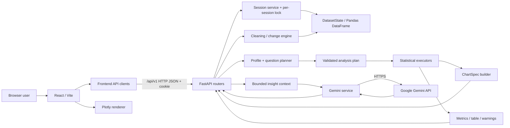
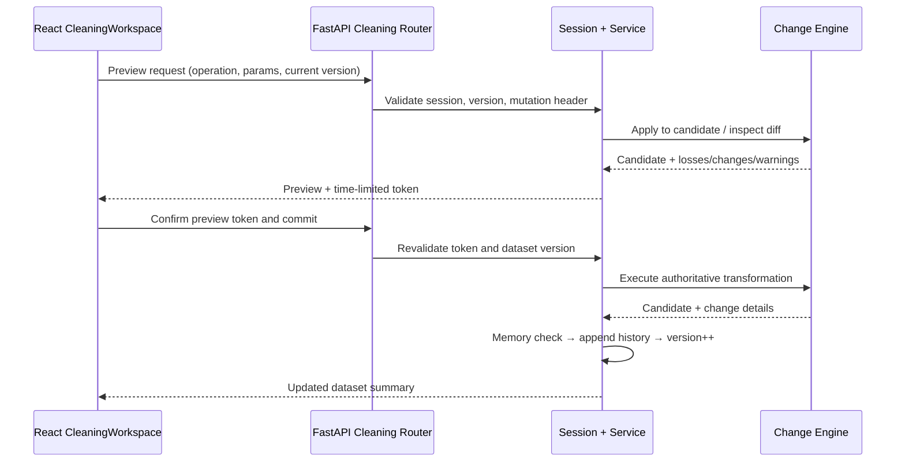
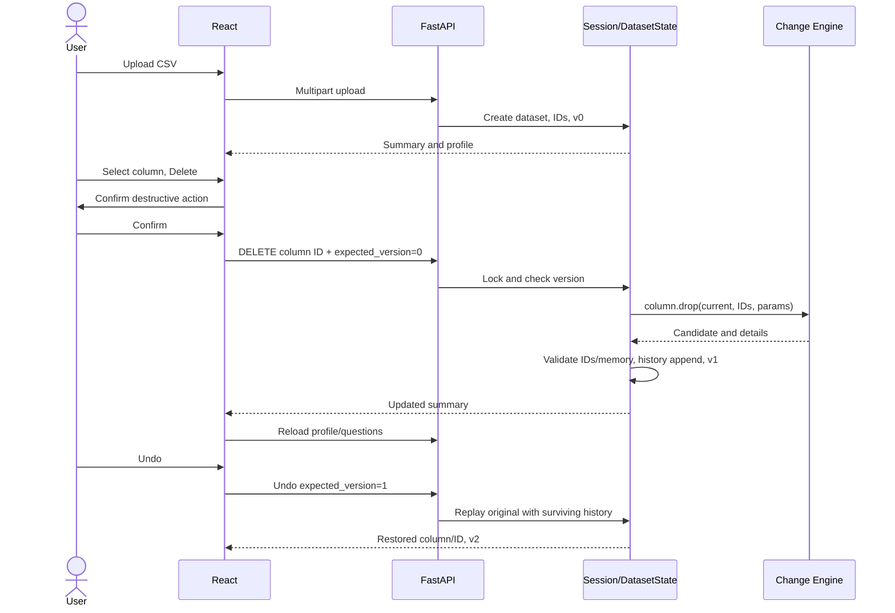
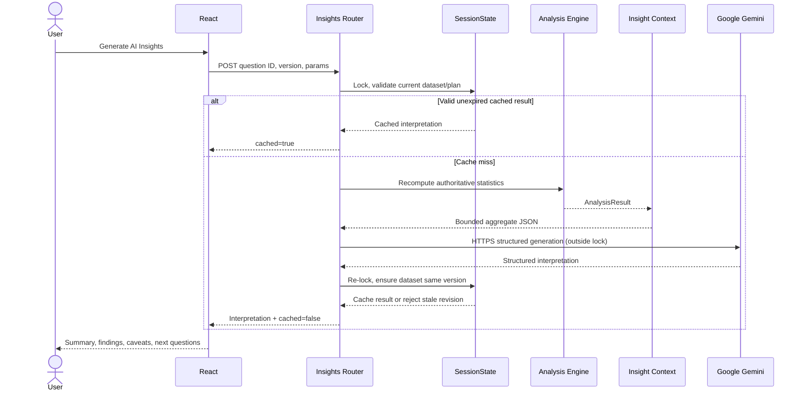

# OmniSight — Comprehensive Technical Documentation

**System:** OmniSight — guided, session-based CSV analytics platform  
**Document class:** Architecture reference · technical specification · implementation guide · maintenance handbook  
**Documentation baseline:** 14 October 2026  
**Primary implementation:** Python/FastAPI/Pandas backend (`backend2/`), React/Vite frontend (`frontend/`), Plotly.js visualization, optional Google Gemini interpretations  
**Document edition:** 1.0 (reconstructed implementation and design reference)  
**Intended readers:** New developers, maintainers, reviewers, collaborators, deployment engineers, technical assessors

> **Important accuracy statement.** This reference reconstructs the current OmniSight architecture from the implementation decisions and code developed in project discussions, the latest supplied `services/datasets.py` extract, an earlier archived codebase, a proposal, and historical API/analysis notes. **A full, current `backend2/` and `frontend/` source snapshot was not supplied for a line-by-line repository audit.** Accordingly, the document explicitly distinguishes **current agreed design / supplied implementation**, **observed local behavior**, **legacy-only behavior**, and **unverified or planned details**. Do not interpret example responses or file layouts as proof of deployed behavior. The running FastAPI `/openapi.json`, current registries, lockfiles, and current source should be treated as the final authority for exact signatures and values.

---

## Contents

1. [Reading conventions and evidence](#1-reading-conventions-and-evidence)
2. [Executive technical overview](#2-executive-technical-overview)
3. [Goals, scope, non-goals and requirements](#3-goals-scope-non-goals-and-requirements)
4. [System architecture and trust boundaries](#4-system-architecture-and-trust-boundaries)
5. [Repository structure and responsibility map](#5-repository-structure-and-responsibility-map)
6. [Technology stack and dependency management](#6-technology-stack-and-dependency-management)
7. [Runtime model, sessions and concurrency](#7-runtime-model-sessions-and-concurrency)
8. [Dataset model, identifiers and versioning](#8-dataset-model-identifiers-and-versioning)
9. [CSV ingestion, profiling and overview](#9-csv-ingestion-profiling-and-overview)
10. [Unified transformation engine and cleaning workflow](#10-unified-transformation-engine-and-cleaning-workflow)
11. [Delete-column feature and reversible history](#11-delete-column-feature-and-reversible-history)
12. [Question-driven analytical planner](#12-question-driven-analytical-planner)
13. [Statistical execution layer](#13-statistical-execution-layer)
14. [Visualization-neutral result contract](#14-visualization-neutral-result-contract)
15. [React frontend architecture and state flow](#15-react-frontend-architecture-and-state-flow)
16. [Gemini insight generation](#16-gemini-insight-generation)
17. [API surface, contracts and errors](#17-api-surface-contracts-and-errors)
18. [Complete end-to-end sequences](#18-complete-end-to-end-sequences)
19. [Security, privacy and data handling](#19-security-privacy-and-data-handling)
20. [Correctness, reproducibility and numerical interpretation](#20-correctness-reproducibility-and-numerical-interpretation)
21. [Configuration and local development](#21-configuration-and-local-development)
22. [Testing and verification strategy](#22-testing-and-verification-strategy)
23. [Performance, resource bounds and scalability](#23-performance-resource-bounds-and-scalability)
24. [Deployment and operational considerations](#24-deployment-and-operational-considerations)
25. [Architectural decision records](#25-architectural-decision-records)
26. [History of the architecture and superseded implementation](#26-history-of-the-architecture-and-superseded-implementation)
27. [Known limitations, open questions and roadmap](#27-known-limitations-open-questions-and-roadmap)
28. [Maintenance and extension playbook](#28-maintenance-and-extension-playbook)
29. [Glossary](#29-glossary)
30. [Source provenance and audit checklist](#30-source-provenance-and-audit-checklist)

---

## 1. Reading conventions and evidence

### 1.1 Status markers

To avoid confusing designs with independently confirmed implementation, this document uses:

| Marker | Meaning |
|---|---|
| **CURRENT DESIGN** | Architecture and interfaces developed for the new `backend2/` + React application in project discussions. |
| **CODE SEEN** | Exact code or structure directly visible in an available source/extract. |
| **USER-OBSERVED** | Behavior the developer reported running or testing locally. |
| **PROPOSED / INTEGRATION PENDING** | Code or configuration was provided as an implementation step, but no full current repository verification was supplied. |
| **LEGACY** | Present in the superseded archive and not to be assumed present in the current system. |
| **PLANNED** | Desired future capability, not an implemented guarantee. |

A feature can have several markers: for example, a chart contract can be **CURRENT DESIGN**, and its Python definition may have been supplied during implementation, while the user's complete production integration remains **INTEGRATION PENDING**.

### 1.2 Sources used

- **Recent code and implementation history:** FastAPI sessions, cleaning, planner, eight analytical executors, chart specifications, React components and on-demand Gemini layer developed in the OmniSight build discussions.
- **Latest shared dataset-service extract:** `Pasted markdown(3).md` (`omnisight/services/datasets.py`), including `DatasetState`, `ChangeRecord`, version checks, history projection, commit, replay, Undo and Reset. The extract at the time of review contained a duplicate `replay_dataset_history` declaration and was followed by a correction in discussion; the corrected file was not independently re-uploaded.
- **Original archive:** `Archive(2).zip`, captured 14 October 2026, containing **older** FastAPI/Streamlit architecture and two earlier analytical approaches. It is evidence of architectural evolution, **not** the definitive current code.
- **Proposal:** `omnisight_project_proposal.md` describing the product vision, in-memory privacy model and four-stage user journey. Some proposal decisions were subsequently refined.
- **Historical engineering references:** `OmniSight-API-Spec.md` (11 October 2026) and `OmniSight-Analysis-Code-Changes.md`, both relating predominantly to the prior architecture. Their endpoints and analysis methods must not be merged into the present API.

### 1.3 Canonical naming conventions

- **OmniSight**: product/application.
- **Dataset**: one CSV uploaded into the browser session; `DatasetState` is its server-side state.
- **Current dataset**: transformed `pandas.DataFrame` currently used by profiling, cleaning, planning and analysis.
- **Original dataset**: baseline DataFrame retained for Undo/replay/Reset.
- **Column ID**: opaque, stable identifier assigned at upload; distinct from the display header.
- **Dataset revision/version**: monotonically increasing integer, not the number of history records.
- **Change operation**: structured, registered, versioned transform with parameters and audit details.
- **Question**: generated, dataset-specific analytical request template with bindings and validated parameters.
- **Validated plan**: backend-authoritative execution instructions resolved from a question.
- **Analysis result**: statistics, bounded table, warnings, metadata and optional chart specification.
- **ChartSpec**: plotting-library-independent JSON representation of a graph.
- **AI insight**: advisory language interpretation of precomputed statistics, never the authoritative calculation.

---

## 2. Executive technical overview

**OmniSight** is a guided, browser-based data analytics application that transforms user-uploaded CSV data into cleaned, interpretable statistical outputs without requiring the user to write SQL, Python or visualization code. The principal workflow is:

```text
Open application / obtain browser session
      ↓
Upload one CSV dataset
      ↓
Inspect current schema, row counts, nulls, preview and column properties
      ↓
Optionally rename or delete columns
      ↓
Preview and commit data-cleaning transformations
      ↓
Generate eligible analytical questions from the current profile
      ↓
Select question and parameters
      ↓
Revalidate against current dataset revision
      ↓
Run deterministic statistical executor
      ↓
Return metrics + bounded result table + warnings + ChartSpec
      ↓
Plotly.js renders the graph; React displays all results
      ↓
Optional explicit request for Gemini interpretation
```

### 2.1 Core technical characteristics

| Property | Current direction |
|---|---|
| Runtime | FastAPI backend and React/Vite frontend in separate development processes. |
| Data model | Single session-owned in-memory Pandas dataset, no relational database required. |
| Ingestion | CSV; discussed maximum upload size approximately **50 MB**. |
| State | Server-owned dataset and history; browser-side selection/display state. |
| Identity | Opaque dataset ID, stable positional column IDs, session cookie. |
| Concurrency | Per-session lock around mutable dataset access; optimistic revision checks. |
| Cleaning | Registry-driven pure transformations, previews, committed history, Undo and Reset. |
| Analytics | Rule-based eligible-question generator with eight registered methods. |
| Visualization | ChartSpec JSON with Plotly.js adapter and renderer in React. |
| AI | Optional `google-genai` interpretation using bounded context from server-computed results. |
| Data persistence | Active process/session memory only; no durable dataset storage. |
| Client/server contract | HTTP JSON, dataset session cookie, explicit mutation-protection header. |
| Package management | `pyproject.toml` and `uv.lock` proposed for Python; `package.json` and `package-lock.json` for React. |

### 2.2 Product versus implementation phases

The **user journey** has four functional stages (ingest/inspect, clean, plan/analyze, visualize/interpret). The **engineering implementation** has been broken into phases 1–5 and later phases 6–9:

1. Session and dataset ingestion.
2. Cleaning operations and reversible history.
3. Rule-based analytical planner.
4. Statistical engines, neutral chart specs, React/Plotly execution UI.
5. Gemini insight interpretation.
6. UI/UX redesign (**planned**).
7. Exports and reporting (**planned**; legacy export does not imply current export).
8. Security, performance and reliability hardening (**planned**).
9. Containerization and production deployment (**planned**).

---

## 3. Goals, scope, non-goals and requirements

### 3.1 Functional goals

1. Accept a CSV and represent its columns accurately, including types, nulls and stable IDs.
2. Let users remove unnecessary columns and rename useful ones without losing the original upload.
3. Allow explicit, inspectable cleaning operations and show potential consequences before committing preview-required transformations.
4. Preserve a chronological transformation history and support stepwise Undo and full Reset.
5. Generate meaningful analytical questions **from the currently eligible schema**, not arbitrary model-generated SQL or raw LLM instructions.
6. Execute numerical, categorical, temporal, relational and missingness analyses through deterministic backend implementations.
7. Return machine-readable statistical results and chart instructions in one response.
8. Visualize results interactively in React without rebuilding statistics in JavaScript.
9. Offer an optional AI interpretation that acknowledges uncertainty, missingness, sampling and aggregation limitations.
10. Invalidate stale downstream results automatically when data, parameters or selections change.

### 3.2 Principal nonfunctional requirements

- **Correctness:** Never silently use columns from an obsolete revision; reject malformed parameters and invalid types.
- **Isolation:** A browser session can access only its own current in-memory dataset when session enforcement is correctly applied.
- **Reversibility:** Rebuild committed state from a preserved original and ordered change history.
- **Determinism:** The same dataset revision, question binding and parameters should produce the same statistical output, subject to numerical-library behavior and bounded deterministic point selection.
- **Bounded outputs:** Avoid returning entire CSVs or unbounded scatter points in ordinary analytical responses.
- **Separation of concerns:** Independent statistical computation, chart specification, UI rendering and LLM interpretation.
- **Privacy awareness:** Do not send raw CSVs to Gemini; explain limitations of aggregated data confidentiality.
- **Maintainability:** Add analytical methods through explicit registry/dispatcher entries rather than ad hoc frontend logic.
- **Development ergonomics:** A teammate should be able to clone, `uv sync`, `npm ci` and run two development servers.

### 3.3 Explicit non-goals for the current stage

- Durable user accounts, roles or authentication against a user database.
- Multi-dataset joins, SQL warehouses or database-backed workspaces.
- Machine learning prediction, automated causal inference, experimental design or arbitrary natural-language query execution.
- Importing arbitrary chart definitions or Python programs from user text.
- LLM-determined statistical formulas or LLM-generated unvalidated analytical plans.
- Distributed multi-worker in-memory session consistency.
- Guaranteed secure handling of highly confidential or regulated data without further threat modeling.
- Automatic AI calls for every analysis; interpretation is **user initiated**.

---

## 4. System architecture and trust boundaries

### 4.1 Component-level architecture



### 4.2 Architectural layers

**Presentation layer:** React components for dataset overview, cleaning workspace, question planner, result cards/tables, Plotly graphs and AI insights. The browser owns UI state but **not the authoritative dataset**.

**Transport/API layer:** FastAPI routers, Pydantic schemas, dependency injection, session checks, operation headers, error mapping and serialization.

**Application-service layer:** Dataset creation, mutation/Undo/Reset, session lifecycle, planner validation and Gemini orchestration. Services enforce cross-component rules and coordinate locks.

**Domain/core layer:** CSV parsing, profiling, transforms, registry, pure analytical executors, chart-spec construction and bounded insight-context construction.

**Infrastructure boundary:** In-memory session store, Pandas/NumPy computation, optional external Gemini HTTP requests. The frontend Plotly bundle is a browser dependency, not a backend computational service.

### 4.3 Principal trust boundaries

| Boundary | Assumed untrusted input | Required control |
|---|---|---|
| Browser → FastAPI | File bytes, column IDs, operation types, request parameters, versions | Pydantic validation, size limits, session/operation checks, handler registry. |
| FastAPI → Pandas | CSV contents and transformation parameters | Parse safeguards, finite/type checks, memory budgets, immutable-style transform discipline. |
| React → analysis | Question ID and parameters | Re-derive authoritative question and bindings server-side. |
| Analysis → chart | Analytical table fields | ChartSpec schema, required-field and finite-number checks. |
| Analytics → Gemini | Labels and aggregate values that may include attacker-controlled strings | Bounded context, prompt/data separation, no dataset mutations or tool execution. |
| Gemini → React | Generated natural language | Structured validation; render as plain text, never unsanitized HTML. |

### 4.4 In-memory implications

OmniSight stores data in application RAM rather than an external database. This avoids a persistence subsystem but creates deliberate constraints:

- A process restart destroys active datasets and history.
- Different backend workers do not inherently share session state.
- Server memory bounds the number and size of simultaneous sessions.
- Undo uses the retained original data and may temporarily allocate additional DataFrames.
- Cookies identify sessions; they are not equivalent to authenticated user identities.
- Backups, recovery, horizontal scaling and durable resume are not provided.

---

## 5. Repository structure and responsibility map

The following layout represents the **current intended modules created during implementation**; compare exact names with the checked-out repository before editing.

```text
OmniSight/
├── backend2/
│   ├── pyproject.toml                # Python project metadata and direct dependencies
│   ├── uv.lock                       # Resolved dependency graph, when using uv
│   ├── .env.example                  # Nonsecret sample configuration (recommended)
│   ├── test_column_drop.py           # Ad hoc regression script (if retained)
│   └── omnisight/
│       ├── __init__.py
│       ├── main.py                   # FastAPI application/router composition
│       ├── config.py                 # Environment-backed settings
│       ├── api/
│       │   ├── deps.py               # Session and mutation dependencies
│       │   ├── routers/
│       │   │   ├── sessions.py
│       │   │   ├── datasets.py
│       │   │   ├── cleaning.py
│       │   │   ├── planner.py
│       │   │   ├── analysis.py
│       │   │   └── insights.py
│       │   └── schemas/
│       │       ├── datasets.py
│       │       ├── cleaning.py
│       │       ├── planner.py
│       │       ├── analysis.py
│       │       └── insights.py
│       ├── services/
│       │   ├── sessions.py           # SessionState, lifetime and locking
│       │   ├── datasets.py           # DatasetState, history/version/Undo/Reset
│       │   ├── cleaning.py           # Preview/commit orchestration
│       │   ├── planner.py            # ValidatedAnalysisPlan, authoritative validation
│       │   └── gemini.py             # Google GenAI client/structured generation
│       └── core/
│           ├── io.py                 # CSV loading
│           ├── profiling.py          # Data/column summaries and semantic types
│           ├── changes/
│           │   ├── registry.py       # Transformation definitions
│           │   ├── engine.py         # CHANGE_HANDLERS + apply_change dispatcher
│           │   ├── cleaning.py       # Pure cleaning operations
│           │   └── preview.py        # Comparison previews
│           ├── planner/
│           │   ├── registry.py       # Question templates and parameter schemas
│           │   ├── generator.py      # Eligible deterministic question catalogue
│           │   └── validation.py     # Parameter validation
│           ├── analysis/
│           │   ├── contracts.py      # Dataclasses for metrics/table/chart/result
│           │   ├── common.py         # Shared numerical/table helpers
│           │   ├── statistics.py     # Descriptive statistics
│           │   ├── numeric.py        # Histogram and pairwise analysis
│           │   ├── grouping.py       # Frequency and grouped aggregation
│           │   ├── temporal.py       # Time counts and aggregations
│           │   ├── quality.py        # Missingness analysis
│           │   ├── charts.py         # Library-independent chart builder
│           │   └── engine.py         # Analysis method dispatcher
│           └── insights/
│               └── context.py        # Bounded interpretation payload
├── frontend/
│   ├── package.json
│   ├── package-lock.json
│   ├── vite.config.js
│   └── src/
│       ├── App.jsx                   # Top-level coordination/session/dataset state
│       ├── index.css
│       ├── api/
│       │   ├── sessions.js
│       │   ├── datasets.js
│       │   ├── cleaning.js
│       │   ├── planner.js
│       │   ├── analysis.js
│       │   └── insights.js
│       └── features/
│           ├── overview/DatasetOverview.jsx
│           ├── cleaning/CleaningWorkspace.jsx
│           ├── planner/QuestionPlanner.jsx
│           ├── analysis/chartAdapter.js
│           ├── analysis/ChartRenderer.jsx
│           ├── analysis/AnalysisResults.jsx
│           └── insights/InsightsPanel.jsx
└── README.md
```

**Repository-name note:** The active backend directory was referenced locally as `backend2/`; some implementation instructions used `backend/`. The correct path is whatever contains the new `omnisight/main.py` and current `pyproject.toml`.

### 5.1 Import/dependency direction

```text
API routers → services → core domain modules
         ↘ API schemas ↗

frontend components → frontend API clients → FastAPI
frontend chart renderer → chartAdapter → backend ChartSpec JSON
```

Prefer core modules that are independent of FastAPI, browser state and Gemini. The chart adapter belongs in the frontend; statistical aggregation belongs only in the backend.

### 5.2 Source of truth by feature

| Concern | Source of truth |
|---|---|
| Active rows, values and headers | `DatasetState.current` |
| Recoverable baseline | `DatasetState.original` |
| Column identity | `DatasetState.column_ids` / `original_column_ids` |
| Mutation history | `DatasetState.history` |
| Dataset revision | `DatasetState.version` |
| Available transformation kinds | `core/changes/registry.py` + `CHANGE_HANDLERS` |
| Available questions | `core/planner/registry.py`, generator/validation |
| Analytical executors | `core/analysis/engine.py::ANALYSIS_EXECUTORS` |
| Chart schema | `core/analysis/contracts.py` and API Pydantic response models |
| External AI interpretation | `services/gemini.py` and `api/schemas/insights.py` |

---

## 6. Technology stack and dependency management

### 6.1 Backend

| Component | Role |
|---|---|
| Python | Primary backend language; local environment observed on Python **3.14**. |
| FastAPI / Starlette | ASGI server framework, routing, dependency injection and HTTP lifecycle. |
| Uvicorn | ASGI development server. |
| Pydantic | Input/output models, validation, JSON contracts. |
| Pandas | CSV reading, in-memory DataFrames, profiles, cleaning and aggregations. |
| NumPy | Histogram binning, finite masks, numeric operations, correlation helpers. |
| `google-genai` | Optional Google Gemini API client and structured generation. |
| Standard library | `dataclasses`, `uuid`, `datetime`, `threading`, `hashlib`, `json`, `copy`, `time`, `logging`. |

### 6.2 Frontend

| Component | Role |
|---|---|
| React | Component state and reactive presentation. |
| Vite | Local development/build tooling and `/api` proxy. |
| JavaScript/JSX | Client code; TypeScript migration was not required. |
| Plotly.js basic distribution | Interactive charts; bar/scatter traces cover categorical, temporal and pre-binned histograms. |
| CSS | Current functional styling; full UI redesign deferred. |
| Fetch API | Session-aware HTTP requests from the API client modules. |

### 6.3 Python dependency declaration

The newer project adopted **`pyproject.toml` + `uv.lock`** as the recommended workflow. A minimal illustrative `pyproject.toml` uses package metadata and direct dependencies:

```toml
[build-system]
requires = ["hatchling"]
build-backend = "hatchling.build"

[project]
name = "omnisight"
version = "0.1.0"
description = "Session-based question-driven CSV analytics"
requires-python = ">=3.12"
dependencies = [
  "fastapi",
  "uvicorn[standard]",
  "pydantic",
  "pandas",
  "numpy",
  "google-genai",
]

[tool.hatch.build.targets.wheel]
packages = ["omnisight"]
```

**Check the actual file.** This example was recommended in discussion; the archived earlier project instead used setuptools and dynamically loaded `requirements.txt`, and the current project may carry additional dependencies. Commit `uv.lock` for repeatable installs and use `uv sync --locked` in clone/deployment workflows.

### 6.4 JavaScript dependency declaration

Use `package.json` plus committed `package-lock.json`. `npm ci` installs from the lockfile; `npm run dev` starts Vite and `npm run build` checks production compilation. The plotting package selected during implementation was `plotly.js-basic-dist-min`. For this design, the frontend contains a lightweight React component using Plotly's own `react()` and `purge()` calls, rather than relying on `react-plotly.js`.

### 6.5 Dependency isolation

`uv sync` creates/manages `.venv` automatically; manual activation is unnecessary for `uv run`. Python and Node packages have separate lockfiles, separate security update cycles and separate build steps.

---

## 7. Runtime model, sessions and concurrency

### 7.1 Session lifecycle

**CURRENT DESIGN:** A browser session is represented server-side by `SessionState`, obtained through `get_active_session` and identified by an opaque cookie (discussed name: `omnisight_session`). Cookie properties used in implementation discussions include `HttpOnly` and path `/api/v1`. The inactivity expiration was discussed as **60 minutes**. Exact `SameSite`, `Secure`, cookie issuance and refresh semantics must be checked against the current `services/sessions.py`/sessions router.

Session creation/access, session cookie transmission, dataset ownership and cleanups are not user authentication. Anyone with access to a valid session cookie may be able to interact with that session; treat it as a bearer credential.

### 7.2 Session responsibilities

The session contains, or coordinates access to:

- One active `DatasetState` at a time.
- A per-session re-entrant lock (`threading.RLock` in the discussed implementation).
- Pending cleaning preview token/state, if a preview is awaiting commit.
- Session activity/expiry information.
- Dataset-scoped completed Gemini interpretations via a bounded cache associated with the dataset.

### 7.3 Concurrency and optimistic locking

A mutation request supplies `expected_version`. Under `session.lock`, the backend compares this value to the authoritative `dataset.version`; mismatch causes a **409 Conflict**. The lock prevents two operations in the same process from interleaving dataset mutation steps. The version check prevents an old browser tab from overwriting a newer state.

```text
Browser A reads version 4 ─────┐
Browser B reads version 4 ─────┼──► server current version = 4
A commits rename expected=4 ──┼──► accepted, version becomes 5
B commits drop expected=4 ────┘   rejected HTTP 409
```

The mutation header `X-OmniSight-Request: 1` is required on mutation endpoints in the proposed current API. It provides an application-specific request gate, but **does not by itself replace a complete CSRF, origin and cookie security design**.

### 7.4 Operations performed under lock

Typical in-lock work: resolve dataset, check version, profile/generate question, apply cleaning transaction, append history, update column metadata and invalidate caches. The discussed Gemini endpoint intentionally builds the context under the lock, releases it for the network call, and reacquires it before caching—rejecting a result if the dataset changed in the meantime.

### 7.5 Limitations of the concurrency model

- `threading.RLock` protects a process-local object, not multiple worker processes or machines.
- A single-worker deployment is simplest without a shared external session datastore.
- Heavy Pandas computation while holding the session lock can serialize all actions from that browser session.
- Process restarts/auto-reload clear server-held dataset state.
- No durable restart recovery or distributed locking is specified.

---

## 8. Dataset model, identifiers and versioning

### 8.1 `DatasetState`

The recent uploaded dataset-service extract shows the following logical fields:

```python
@dataclass
class DatasetState:
    id: str
    filename: str
    original: pd.DataFrame
    current: pd.DataFrame
    source_size_bytes: int
    estimated_memory_bytes: int
    column_ids: list[str] = field(default_factory=list)
    version: int = 0
    uploaded_at: datetime = field(default_factory=utc_now)
    history: list[ChangeRecord] = field(default_factory=list)
    profile_cache: dict | None = None
    profile_version: int = -1
    insights_cache: dict[str, dict] = field(default_factory=dict)
    original_column_ids: list[str] = field(default_factory=list)
```

The pseudocode `utc_now` stands for the actual `datetime.now(timezone.utc)` default factory. In the recent code, `__post_init__` snapshots original column IDs from the current IDs if no snapshot was explicitly supplied.

### 8.2 Stable IDs versus headers

Newly uploaded columns receive IDs of the form `col_<UUID-hex>` in the newer implementation; they are generated once per upload in `create_dataset()`. IDs are positionally aligned with DataFrame columns:

```text
position    0          1             2
name      Region     Revenue        Revenue
id        col_a...   col_b...       col_c...
```

- Rename alters a display name but **not** its stable ID.
- Deletion removes exactly one active column ID and the corresponding position.
- `original_column_ids` is retained as the baseline for replay/Undo/Reset.
- Do not use a header string as an authoritative column selector; labels may be duplicated or renamed.
- The UI should display human-readable names but submit stable IDs.

### 8.3 Original versus current DataFrame

`original` is the replay baseline; `current` is the active analytical dataset. In the recent code, both initially reference the same uploaded DataFrame. Transforms must respect the documented **nonmutation contract**, returning transformed DataFrames rather than modifying the baseline in place. `DataFrame.copy(deep=False)` creates a shallow copy, **not** a guarantee that every underlying array is physically independent; this requires tests across transformation implementations and the deployed Pandas copy-on-write settings.

### 8.4 Version semantics

- New upload: typically version `0`.
- Successful committed transformation: version `+1`.
- Undo of a committed operation: version `+1` despite history becoming shorter.
- Reset after changes: version `+1` and history cleared.
- Rejected, invalid, preview-only or no-op transformation: does **not** increment version.

Example: `[upload v0] → [drop v1] → [rename v2] → [undo v3] → [undo v4]`; history length after the last Undo is zero even though version is four.

### 8.5 `ChangeRecord`

```python
@dataclass(frozen=True)
class ChangeRecord:
    id: str
    kind: str
    parameters: dict[str, Any]
    details: dict[str, Any]
    created_at: datetime
```

A record captures the operation kind, **deep-copied input parameters**, outcome details and a timestamp. It is chronological and replayable; it is not a materialized full-DataFrame snapshot.

### 8.6 Invariants

At every committed revision:

```text
len(dataset.column_ids) == len(dataset.current.columns)
len(dataset.original_column_ids) == len(dataset.original.columns)
all active column IDs are unique
active column IDs are an ordered subsequence of original IDs
history can be replayed from original to produce current
profile_cache is valid only when profile_version == version
```

The implementation must enforce the invariants both after commits and during Undo/replay. A version check alone cannot detect structural corruption.

---

## 9. CSV ingestion, profiling and overview

### 9.1 Upload sequence

1. Browser selects or drags a CSV file.
2. Frontend posts multipart form data to FastAPI with session cookie.
3. Backend enforces upload limits; the design target is approximately **50 MB**.
4. CSV parser constructs an in-memory Pandas DataFrame.
5. Dataset service allocates stable column IDs, stores `original`/`current`, records filename, source bytes and memory estimate, sets version zero.
6. Profile builder computes dataset/column metadata.
7. API returns serializable overview data and a bounded preview.
8. React updates the session dataset state and displays the overview.

The precise CSV encoding, delimiter detection, Pandas `read_csv` options, duplicate-header behavior and error details must be audited in the newer `core/io.py`. The old archive uses UTF-8 and comma-separated CSV and must **not** be treated as automatically confirming the newer parser.

### 9.2 Profiling contract

The current profile design includes the dataset identity and revision, row/column counts, missingness and per-column details. The analytical generator uses column semantic classifications, including:

| Semantic classification | Meaning for planning |
|---|---|
| `numeric` | Suitable for numerical summaries, histograms, measures and relationships if finite data exists. |
| `categorical` | Suitable for bounded category distributions/grouping. |
| `boolean` | Distinct from numerical measures in eligible-template rules. |
| `text` | Not implicitly a numerical measure; may require conversion. |
| `datetime` | Parsed/converted temporal values eligible for temporal methods. |
| `datetime_candidate` | Text suspected of containing dates, not yet necessarily eligible. |

Semantic labels do not always correspond one-to-one to raw Pandas dtype strings. Question eligibility is determined by the **current profile** after cleaning—not the original uploaded schema.

### 9.3 Overview content

The overview displays: current row and column counts, per-column names and types, missing values/percentages, representative values/preview, selected-column details, and column management actions. The **Delete Column** action was added immediately before **Rename Column**. Both use the currently selected stable column ID.

### 9.4 Profile caching

`profile_dataset()` recomputes only if the cached profile is absent or `profile_version != dataset.version`. Every successful mutation invalidates the profile cache and increments the revision; no-op operations leave it unchanged. Since the planner reads the current profile, its eligible questions change after rename, delete, numeric conversion, datetime conversion, row deletion and Undo.

### 9.5 Example state transition

```text
Upload (version 0): Employee, Address, Salary
Delete Address (v1): Employee, Salary
Rename Salary → Monthly Salary (v2): Employee, Monthly Salary
Undo (v3): Employee, Salary
Undo (v4): Employee, Address, Salary
```

The restored `Address` column must retain its original position, values **and stable ID**.


---

## 10. Unified transformation engine and cleaning workflow

### 10.1 Motivation

The original architecture had specialized cleaning routines and analysis routines. The newer implementation establishes **one unified dataset mutation model** for rename, delete, cleaning and Undo. Different UI features do not own independent history stacks or edit separate DataFrame copies.

### 10.2 Core building blocks

- `core/changes/registry.py`: definitions of allowed operation kinds, labels, categories and preview/schema-change flags.
- `core/changes/engine.py`: `apply_change(dataframe, column_ids, kind, parameters)` and a dispatch dictionary (`CHANGE_HANDLERS`).
- `core/changes/cleaning.py`: pure operation implementations.
- `core/changes/preview.py`: before/after comparison logic and preview details.
- `services/datasets.py`: authoritative version check, memory budget, `ChangeRecord` creation and atomic commit.
- `services/cleaning.py`: preview/commit coordination, pending token validation and session workflow.
- `api/routers/cleaning.py` and `api/routers/datasets.py`: transport boundary and error mapping.

### 10.3 Registry versus dispatcher: two required registrations

A change type needs **both** a schema/metadata entry and an executable mapping. The recent column-delete debugging confirmed an operational distinction:

```python
# Registry declares what the operation is.
# Conceptual metadata:
"column.drop": ChangeDefinition(...)

# Engine dispatcher declares how it runs:
CHANGE_HANDLERS = {
    "column.rename": apply_column_rename,
    "column.drop": apply_column_drop,
    # ... cleaning operations
}
```

The actual dispatcher is:

```python
def apply_change(dataframe, column_ids, kind, parameters):
    get_change_definition(kind)
    handler = CHANGE_HANDLERS.get(kind)
    if handler is None:
        raise NotImplementedError(f"No executor implemented for {kind}")
    return handler(dataframe, column_ids, parameters)
```

**USER-OBSERVED incident:** The `column.drop` registry entry existed but `CHANGE_HANDLERS` initially lacked a mapping, producing `NotImplementedError: No executor implemented for column.drop` from `core/changes/engine.py`. The developer subsequently reported the fix was good. This is an important extension checklist item: adding a registry definition alone is insufficient.

### 10.4 Pure transform contract

Each handler accepts:

```python
(dataframe: pd.DataFrame,
 column_ids: list[str],
 parameters: dict[str, Any])
    -> tuple[pd.DataFrame, dict[str, Any]]
```

The first return value is the candidate transformed DataFrame. The second is an outcome/details object, commonly including `changed`, count or column metadata. The handler must not directly update session history, dataset version, cookie state or profile caches.

Typical invariants:

1. Validate expected parameters and reject unexpected fields where applicable.
2. Resolve columns by stable ID against the **pre-change** aligned ID list.
3. Operate only on the selected column(s)/rows as permitted.
4. Produce an independently usable candidate DataFrame.
5. Report whether anything actually changed and provide human-readable details.
6. Let the application service decide whether to commit.

### 10.5 Cleaning preview and commit

The cleaning system follows a preview-first workflow for operations marked `requires_preview=True`:



The discussed pending-preview time-to-live is **300 seconds (five minutes)**. A preview is invalidated by an intervening dataset edit, expiration or a new upload. Preview-generation itself must not mutate `current`, `history` or `version`.

Column rename/drop were designed as direct commits using explicit confirmation or a form, not necessarily the preview-token system. Both still use the **same history and version engine**.

### 10.6 Supported transformation categories

The implementation discussion refers to **nine cleaning transformations** in addition to schema-management actions. The exact current registry keys for every cleaning operation were not available in the latest source snapshot. The following are the **capabilities explicitly discussed**; inspect `core/changes/registry.py` for their canonical `kind`, parameter schema and preview flags.

| Capability | Semantics / critical rules |
|---|---|
| Rename column | Update selected display label; stable ID unchanged; enforce name constraints where configured. |
| Delete column (`column.drop`) | Remove one selected stable column ID; disallow final-column deletion; audit and Undo. |
| Strip prefix/suffix | Remove selected literal affix from eligible string cells; avoid silently coercing unrelated values. |
| Formatting character cleanup | E.g., remove commas or specified symbols; decimal-comma ambiguity must be surfaced. |
| Numeric type conversion | Coerce eligible values under explicit policy; count invalid/unconvertible values and reject/preview data loss as configured. |
| Datetime type conversion | Convert an eligible date-like column to Pandas datetime so temporal questions become available. |
| Missing-value inspection/replacement | Identify nulls plus optional configured tokens; fill using calculated or supplied values. |
| Missing-value row removal | Drop entire rows meeting the selected missingness rule. |
| Duplicate-row removal | Remove duplicate records under the supported selection policy. |
| Other registered cleaning actions | Source registry is authoritative; do not infer unsupported `kind` strings. |

Numeric conversion, datetime conversion, missing-value handling and duplicate removal change the question catalogue indirectly through the newly computed profile.

### 10.7 Missing value semantics

**Missingness** may include Pandas nulls (`NaN`, `NaT`, `pd.NA`) and, where the cleaning operation supports it, optionally recognized empty strings, whitespace-only strings and whole-cell tokens. Ordinary literal text such as `N/A` must not be assumed missing under every cleaning configuration unless the current parser/cleaner recognizes it. These rules can change both row removal and numeric conversion outcomes.

Statistical imputation has implicit assumptions: mean may be distorted by outliers, median is robust to them, mode can have ties, and constant fills impose a user-chosen value. Record actual strategy/parameters in change history; preserve loss information in previews/warnings.

### 10.8 Commit transaction

A robust dataset commit follows this order:

```text
1. Check expected_version against dataset.version.
2. Resolve kind in allowed registry.
3. Deep-copy parameters for immutable history evidence.
4. Execute handler against current DataFrame and current column IDs.
5. Return without history/version change if no-op.
6. Estimate candidate DataFrame memory and enforce configured budget.
7. Create ChangeRecord with kind, parameters, details, timestamp.
8. Prepare new history and calculate new active column IDs from original+history.
9. Validate number of resulting columns equals number of active IDs.
10. Assign current, history, column_ids, memory estimate; increment version.
11. Invalidate derived dataset profile (and any pending preview).
12. Return updated state and record.
```

The recent `datasets.py` extract was updated to calculate `new_history` and `new_column_ids` **before** assigning `dataset.current`. This avoids a partially updated state if ID projection fails. It also documents the intended property: *a failing transformation must not modify session dataset state*.

### 10.9 Memory accounting

`dataframe_memory_bytes(frame)` uses `frame.memory_usage(index=True, deep=True).sum()` in the shared code. `enforce_memory_limit` raises `DatasetMemoryLimitError` when the configured budget is exceeded. This is a **DataFrame estimate**, not an exact measurement of total process resident memory: the original DataFrame, temporary candidate frames, caches, NumPy arrays and Python overhead may coexist.

### 10.10 History replay model

Undo is not implemented by storing one full DataFrame snapshot for every action. Instead, the service retains a baseline `original` and replays the **remaining sequence of committed transformations**. This favors a compact record log but makes Undo cost proportional to the history and transformation work. Replays must be deterministic and must use the correct **working column IDs at each historical step**.

### 10.11 Nonmutating versus persistent-within-session

A committed cleaning operation modifies the **working** dataset and stays effective through navigation or browser refresh within the valid session. It does not modify the user's original file or the preserved baseline. “Persistent” here describes **session state**, not disk durability.

---

## 11. Delete-column feature and reversible history

### 11.1 User requirement

The Dataset Overview includes a **Delete Column** action directly before the existing Rename option. A user can remove any unwanted column except the last one. The action should be confirmed, recorded in unified history, preserved within the session and reversible by Undo/Reset. This feature was added after the primary analytics implementation.

### 11.2 Operation identity and parameters

```json
{
  "kind": "column.drop",
  "parameters": {"column_id": "col_opaque_id"},
  "expected_version": 3
}
```

`column_id` must be an existing active ID. Extra parameters are rejected by the discussed handler. Deletion uses stable position rather than `DataFrame.drop(columns=[display_name])`, which might remove multiple duplicate-name occurrences.

### 11.3 Exact transformation algorithm

Given `column_ids`, locate `position = column_ids.index(column_id)` and retain all other positions:

```python
positions = [i for i in range(len(column_ids)) if i != position]
result = dataframe.iloc[:, positions].copy(deep=False)
```

Result details include `changed`, `column_id`, `column_name`, original position and column counts before/after. The handler returns the new DataFrame; the service updates the active ID list and history.

### 11.4 Protection against dropping the last column

If the active dataset has one remaining column, reject the operation (discussed exception: `CannotDropLastColumn`, HTTP `422`). The frontend also disables the delete button in this state. Backend validation is mandatory regardless of the UI guard.

### 11.5 Stable-ID history projection

The uploaded code's `column_ids_for_history(dataset, history)` starts from `dataset.original_column_ids`, walks committed records and removes IDs for `column.drop` entries. Rename and ordinary cleaning do not change this list. Duplicate drop records or attempts to delete the final column indicate invalid history.

This projection is run before commit and after Undo; Reset restores `original_column_ids` directly.

### 11.6 Replay and chronological Undo

For every historical operation:

```text
working DataFrame = original shallow copy
working IDs = original_column_ids copy
for operation in remaining history:
    assert len(working.columns) == len(working IDs)
    apply_change(working, working IDs, kind, params)
    if operation == column.drop:
        remove dropped ID from working IDs
    validate alignment and optional memory constraints
return reconstructed DataFrame
```

Undo removes only the **latest** operation; it does not selectively reverse an arbitrary earlier action. To restore a deletion that occurred before a rename, first undo the rename, then undo the deletion. Reset discards the whole history and restores the baseline.

### 11.7 API and frontend integration

The discussed REST endpoint is:

```http
DELETE /api/v1/datasets/current/columns/{column_id}
Content-Type: application/json
X-OmniSight-Request: 1
Cookie: omnisight_session=...

{"expected_version":3}
```

`DatasetOverview.jsx` shares its selected column with Rename; it calls an `onDelete` callback supplied by `App.jsx`. The parent shows a confirmation prompt and calls `frontend/src/api/datasets.js::deleteDatasetColumn`. On success, React replaces the dataset summary with the returned updated version. Existing Cleaning and Planner components reload on dataset version change.

### 11.8 Debugging record and regression emphasis

Two significant integration failures were encountered during the addition:

1. An intermediate `datasets.py` edit accidentally introduced **two** `replay_dataset_history()` definitions and removed/misnamed `undo_dataset_change()`. The corrected design restores both functions separately and validates reconstructed IDs **before** committing restored state. The corrected final file was not independently re-uploaded.
2. The actual deletion endpoint reached the change engine but raised `NotImplementedError: No executor implemented for column.drop`. The dispatcher used `CHANGE_HANDLERS`; adding `"column.drop": apply_column_drop` was the required wiring. The user subsequently reported this fix working.

### 11.9 Regression test scenario

```text
Upload:    Name | Address | Salary
Drop:      Name | Salary                  (version +1)
Rename:    Name | Monthly Salary          (version +1)
Undo:      Name | Salary                  (version +1)
Undo:      Name | Address | Salary        (version +1)
```

Check names, original `Address` values, original column position, stable ID, version increments, correct history length and updated question eligibility. Test duplicate headers by deleting one ID and confirming the other survives.

---

## 12. Question-driven analytical planner

### 12.1 Reason for the redesign

The archived backend contained multiple partially overlapping analytical approaches: low-level analysis helpers, extra statistical routines and a goal-based analysis planner. The current redesign **intentionally discards the older analysis architecture** in favor of one rule-based **question template → validated plan → registered statistical method** pipeline. The user chose this design as the sole analytical approach rather than maintaining compatibility/migration layers.

### 12.2 Planner responsibilities

The planner decides which question templates are valid for the current profile; which stable column IDs bind each role; permitted parameters; which method executes; the visualization intent; and a deterministic dataset-specific question ID. It **does not** calculate statistics or call Gemini.

### 12.3 Template registry

| Template ID | Analysis method | Visualization |
|---|---|---|
| `numeric.summary` | `descriptive_statistics` | `statistics` |
| `numeric.distribution` | `histogram` | `histogram` |
| `category.frequency` | `value_counts` | `bar` |
| `category.numeric` | `grouped_aggregation` | `bar` |
| `numeric.relationship` | `pairwise_relationship` | `scatter` |
| `time.metric_trend` | `time_aggregation` | `line` |
| `time.record_count` | `time_counts` | `line` |
| `dataset.missingness` | `missing_values` | `bar` |

Templates are **families**. Different valid column bindings produce different question instances from a family.

### 12.4 Generator and catalog

A representative contract from implementation:

```python
generate_questions(
    dataset_id: str,
    dataset_version: int,
    profile: dict,
    max_questions: int = 80,
) -> dict
```

Catalog structure:

```json
{
  "dataset_id": "dataset-opaque",
  "dataset_version": 2,
  "generator_version": "implementation-specific",
  "total_questions": 5,
  "questions": [{
    "id": "q_...",
    "template_id": "numeric.distribution",
    "category": "numeric",
    "title": "How is Salary distributed?",
    "description": "...",
    "bindings": {"column_id": "col_..."},
    "parameters": {"bins": 20},
    "parameter_schema": {},
    "analysis_method": "histogram",
    "visualization_intent": "histogram"
  }]
}
```

**Illustrative:** Actual binding field names and parameter schemas come from `core/planner/registry.py` and the running endpoint; do not synthesize question IDs in React.

### 12.5 Question ID and eligibility

Question IDs are designed as `q_` plus 24 hexadecimal characters, deterministic for a stable dataset and generator. They are **revision-scoped**, not durable bookmarks.

Eligibility rules discussed:

- Numeric columns require usable finite values.
- Categoricals are limited to manageable cardinality (threshold approximately **25** distinct values).
- Parsed `datetime` columns require at least two distinct usable times; a mere `datetime_candidate` is not sufficient.
- Temporal aggregation also requires an eligible numerical measure.
- Pairwise methods bind distinct numerical columns.
- Missingness questions depend on the profile's null counts.
- The catalog is bounded; default max question count **80**.

**USER-OBSERVED:** Temporal templates were reported as “Not generated” for one local test. Possible causes: no converted datetime column, insufficient distinct dates, missing numeric measure, or earlier questions consuming the 80-question cap. Absence is not proof of an API error.

### 12.6 Parameters

| Method | Parameter | Values / defaults discussed |
|---|---|---|
| Histogram | `bins` | Integer 5–60, default 20 |
| Frequency | `top_n` | Integer 1–30, default 10 |
| Grouped aggregation | `aggregation` | `mean` / `sum` / `median`, default `mean` |
| Grouped aggregation | `top_n` | Bounded positive integer |
| Relationship | `max_points` | Integer 100–5000, default 1000 |
| Temporal | `frequency` | `day`, `week`, `month`, `year`; default `month` |
| Temporal aggregation | `aggregation` | Default `sum` |
| Summary / missingness | — | No user parameter |

The backend rejects unexpected fields or invalid types. For example, boolean values should not be silently accepted as integer settings.

### 12.7 Server-authoritative validation

Frontend request:

```json
{
  "question_id": "q_<generated_id>",
  "expected_version": 4,
  "parameters": {"bins": 20}
}
```

The backend's `validate_analysis_request` rechecks revision, rebuilds profile/catalog, resolves the question, validates overrides and returns a frozen `ValidatedAnalysisPlan`. React never supplies an unrestricted executable method/column combination.

### 12.8 `ValidatedAnalysisPlan`

```python
@dataclass(frozen=True)
class ValidatedAnalysisPlan:
    dataset_id: str
    dataset_version: int
    question_id: str
    template_id: str
    title: str
    category: str
    analysis_method: str
    visualization_intent: str
    bindings: dict[str, str]
    parameters: dict[str, int | str]
    generator_version: str
```

### 12.9 Planner endpoints

- `GET /api/v1/planner/questions` — generate/current catalog.
- `POST /api/v1/planner/validate` — validate request and expose resolved plan.

The execute endpoint validates internally; manual Validate is optional. The UI Validate button is useful for inspecting the resolved plan.

---

## 13. Statistical execution layer

### 13.1 Dispatcher

```python
ANALYSIS_EXECUTORS = {
    "descriptive_statistics": run_descriptive_statistics,
    "histogram": run_histogram,
    "value_counts": run_value_counts,
    "grouped_aggregation": run_grouped_aggregation,
    "pairwise_relationship": run_pairwise_relationship,
    "time_counts": run_time_counts,
    "time_aggregation": run_time_aggregation,
    "missing_values": run_missing_values,
}
```

Executor signature:

```python
Executor = Callable[
    [pd.DataFrame, list[str], ValidatedAnalysisPlan],
    AnalysisResult,
]
```

`execute_validated_plan()` checks column count/ID alignment, resolves the registered method, runs its executor, invokes `build_chart_spec(plan, result)` and attaches the chart using `dataclasses.replace()` on a frozen result.

### 13.2 Shared numerical conventions

- Resolve columns by **stable ID**.
- Operate on the **full current DataFrame**, not paginated preview rows.
- Apply finite/null rules specific to each statistical method and expose excluded counts.
- Represent undefined or nonfinite JSON metrics as `null` with explanations.
- Bound graph/table payloads while calculating authoritative summary statistics on all valid observations.
- Be explicit about denominators: full row count, finite observation count, valid pair count or group size.

### 13.3 Descriptive statistics (`descriptive_statistics`)

**Module:** `core/analysis/statistics.py`. Summarizes one numeric column: valid count, mean, median, quartiles (`q1`, `q3`), standard deviation and other available count/quality metrics. Generally returns metric cards, `table=None`, `chart=None`.

Sample mean:

\[
\bar{x}=\frac{1}{n}\sum_{i=1}^{n} x_i.
\]

Sample standard deviation, **if** implementation uses `ddof=1`:

\[
s=\sqrt{\frac{1}{n-1}\sum_{i=1}^{n}(x_i-\bar{x})^2}.
\]

Verify whether the live code uses sample or population standard deviation before labeling it. A single valid observation can make sample standard deviation undefined.

### 13.4 Histogram (`histogram`)

**Module:** `core/analysis/numeric.py`. Calculates `numpy.histogram` over finite values. Parameter `bins` (5–60, default 20); output `bin_start`, `bin_end`, `count`; metadata includes selected column, `bin_count` and `valid_observations`. Bins are `[start, end)`, except the final includes its upper bound. Plotly must **not** re-bin these counts.

### 13.5 Categorical frequency (`value_counts`)

**Module:** `core/analysis/grouping.py`. Uses non-null `value_counts` for a selected column. Table `category`, `count`, `percent`; count-descending order; top-N bound; metadata gives percentage denominator. Percentage formula:

\[
p_k=100\frac{n_k}{N_{\text{nonmissing}}}.
\]

Displayed percentages need not sum to 100% when only top categories are returned. Do not renormalize in the frontend without an explicit alternate metric.

### 13.6 Grouped aggregation (`grouped_aggregation`)

**Module:** `core/analysis/grouping.py`. Groups a numeric measure by another column and applies validated `mean`, `sum` or `median`. Table `category`, `value`, `count`; descending aggregate sort with top-N limit; metadata records column names/IDs, aggregation and order.

Mean for group \(g\): \(\bar{x}_g = (\sum_{i\in g}x_i)/n_g\), where the denominator follows executor null/finite rules. Ranking of groups is not a randomized sample.

### 13.7 Pairwise relationship (`pairwise_relationship`)

**Module:** `core/analysis/numeric.py`. Selects rows with finite numeric values in **both** columns. Computes Pearson's coefficient using all valid pairs, but returns a bounded, position-selected set of `x`, `y` rows for plotting (default 1000, maximum 5000). Metadata includes IDs/names and sampling, metrics include valid pairs, excluded rows and coefficient.

\[
r=\frac{\sum_i (x_i-\bar{x})(y_i-\bar{y})}
{\sqrt{\sum_i(x_i-\bar{x})^2}\sqrt{\sum_i(y_i-\bar{y})^2}}.
\]

Insufficient pairs and constant columns make Pearson correlation undefined. Correlation is not causation. No generic p-value calculation is specified in the redesigned eight-method system.

### 13.8 Temporal record counts (`time_counts`)

**Module:** `core/analysis/temporal.py`. Converts datetime values into Pandas periods: `D`, `W-SUN`, `M`, `Y`; groups records by period; returns `period` ISO start date plus `count`; output is bounded to the **240 most recent observed periods**. Metadata specifies frequency, week-start and timezone basis. Missing periods are not inherently zero.

### 13.9 Temporal measure trend (`time_aggregation`)

**Module:** `core/analysis/temporal.py`. Groups numeric values by datetime period with chosen aggregation and frequency. Table `period`, `value`, `count`; maximum 240 periods; metadata records time/measure IDs, aggregation, frequency, week-start and timezone. Do not assume `count` always equals all original records; check implementation's valid-measure handling.

### 13.10 Missing values (`missing_values`)

**Module:** `core/analysis/quality.py`. Computes `column_id`, `column`, `missing_count`, `missing_percent`, sorted by missing count descending. Bounded to about **100 columns**; metadata gives dataset row/column counts and total cells.

For \(R>0\) rows and \(m_c\) missing entries: \(\text{missingPercent}(c)=100m_c/R\). Confirm the empty-data convention from implementation.

### 13.11 Read-only execution guarantee

Executing analysis must never modify dataset rows, column IDs, history, version or pending cleaning state. A completed chart/statistical result is ephemeral read-only derived data. The newly generated `execution_id` identifies that run, not a persistent database record.

### 13.12 Statistical limitations

The current architecture supports the eight registered methods—not generic inferential tests, causal inference or machine learning. Histograms depend on bin choice; Pearson detects linear association; top-N category/group tables omit a tail; temporal interpretations depend on parsing/frequency boundaries. Any formerly implemented Welch/ANOVA/p-value routines in the **archived** code are **legacy** and must not be claimed for the new engine.

---

## 14. Visualization-neutral result contract

### 14.1 Motivation

The backend performs analytical calculations and returns **instructions and bounded data for presentation**, not screenshots, Matplotlib figures, Plotly objects or HTML. The React frontend maps the neutral result to Plotly. This decoupling is a central architectural decision.

### 14.2 Domain dataclasses

**Current design, from `core/analysis/contracts.py`:**

```python
JsonScalar = str | int | float | bool | None
DataType = Literal["nominal", "quantitative", "temporal", "boolean"]
ChartKind = Literal["bar", "line", "scatter", "histogram"]

@dataclass(frozen=True)
class AnalysisMetric:
    key: str
    label: str
    value: JsonScalar
    unit: str | None = None

@dataclass(frozen=True)
class TableColumn:
    key: str
    label: str
    data_type: DataType

@dataclass(frozen=True)
class AnalysisTable:
    columns: list[TableColumn]
    rows: list[dict[str, JsonScalar]]
    total_rows: int
    truncated: bool = False

@dataclass(frozen=True)
class ChartAxis:
    field: str
    label: str
    data_type: DataType

@dataclass(frozen=True)
class ChartSpec:
    kind: ChartKind
    title: str
    x: ChartAxis
    y: ChartAxis
    data: list[dict[str, JsonScalar]]
    series_field: str | None = None
    metadata: dict[str, JsonScalar] = field(default_factory=dict)
    schema_version: Literal["1.0"] = "1.0"

@dataclass(frozen=True)
class AnalysisResult:
    metrics: list[AnalysisMetric] = field(default_factory=list)
    table: AnalysisTable | None = None
    chart: ChartSpec | None = None
    warnings: list[str] = field(default_factory=list)
    metadata: dict[str, JsonScalar] = field(default_factory=dict)
```

`AnalysisExecutionResponse` additionally includes `schema_version`, a unique execution ID, UTC execution timestamp, serialized validated plan and result. The API Pydantic models use `extra="forbid"` and nonfinite JSON rejection (`allow_inf_nan=False` in the described design).

### 14.3 Mapping table

| Method | Chart kind | X field and semantics | Y field |
|---|---|---|---|
| `descriptive_statistics` | none | — | — |
| `histogram` | `histogram` | `bin_start` quantitative; `bin_end` carried in each row | `count` |
| `value_counts` | `bar` | `category` nominal | `count` |
| `grouped_aggregation` | `bar` | `category` nominal | `value` |
| `pairwise_relationship` | `scatter` | `x` quantitative | `y` quantitative |
| `time_counts` | `line` | `period` temporal | `count` |
| `time_aggregation` | `line` | `period` temporal | `value` |
| `missing_values` | `bar` | `column` nominal | `missing_count` |

### 14.4 Example execution response

```json
{
  "schema_version": "1.0",
  "execution_id": "run_illustrative-id",
  "executed_at": "2026-10-14T12:00:00Z",
  "plan": {
    "dataset_id": "dataset-opaque",
    "dataset_version": 2,
    "question_id": "q_example",
    "template_id": "category.frequency",
    "title": "How frequent is each Department?",
    "category": "categorical",
    "analysis_method": "value_counts",
    "visualization_intent": "bar",
    "bindings": {"column_id": "col_example"},
    "parameters": {"top_n": 10},
    "generator_version": "implementation-specific"
  },
  "result": {
    "metrics": [{"key":"valid_count","label":"Valid values","value":5,"unit":null}],
    "table": {
      "columns": [
        {"key":"category","label":"Department","data_type":"nominal"},
        {"key":"count","label":"Count","data_type":"quantitative"},
        {"key":"percent","label":"Percentage","data_type":"quantitative"}
      ],
      "rows": [
        {"category":"Engineering","count":3,"percent":60.0},
        {"category":"Marketing","count":2,"percent":40.0}
      ],
      "total_rows": 2,
      "truncated": false
    },
    "chart": {
      "schema_version":"1.0",
      "kind":"bar",
      "title":"How frequent is each Department?",
      "x":{"field":"category","label":"Department","data_type":"nominal"},
      "y":{"field":"count","label":"Count","data_type":"quantitative"},
      "data":[
        {"category":"Engineering","count":3,"percent":60.0},
        {"category":"Marketing","count":2,"percent":40.0}
      ],
      "series_field":null,
      "metadata":{"analysis_method":"value_counts","percentage_field":"percent"}
    },
    "warnings":[],
    "metadata":{}
  }
}
```

**Illustrative contract:** Some result metadata and plan binding names have been shortened/filled for explanation. Use `/openapi.json` and actual successful responses for exact production schemas.

### 14.5 Chart builder behavior

`core/analysis/charts.py` receives a `ValidatedAnalysisPlan` and **the completed AnalysisResult**, checks required table fields, then produces ChartSpec without recomputing statistics. It includes total rows, displayed rows, truncation, analysis method, question ID and dataset version in metadata. Missing or unexpected table fields are programmer/schema errors, not invitations to silently estimate chart values.

### 14.6 Pre-binned histogram rendering

The frontend `chartAdapter.js` converts each `{bin_start, bin_end, count}` row to a Plotly **bar** trace:

```javascript
xCenter = (bin_start + bin_end) / 2;
width = bin_end - bin_start;
y = count;
```

Rendering a new Plotly `histogram` trace from the bin count rows would histogram the **aggregates**, not the original observations. This distinction is correctness-critical.

### 14.7 Plotly trace mapping

- Backend `bar` → Plotly `{type:"bar", x:categories, y:values}`.
- Backend `scatter` → Plotly `{type:"scatter", mode:"markers"}`.
- Backend `line` → Plotly `{type:"scatter", mode:"lines+markers"}` with date X axis.
- Backend `histogram` → Plotly `{type:"bar", x:binCenters, y:counts, width:binWidths}`.

The adapter can use percentage fields for hover text without affecting data. The renderer uses `Plotly.react()` for updates, `Plotly.purge()` for cleanup and dynamic import so the library is loaded only when charts are needed.

### 14.8 Chart limitations and UX obligations

- A line chart connecting periods with no observations **does not imply zeros** in those gaps.
- Bounded scatter data may omit points even though Pearson metrics use all valid pairs.
- Category values in a truncated table may not represent the population distribution.
- Precision formatting belongs in React, but original machine-readable values must remain available.
- SVG/canvas image export through Plotly is frontend capability; a full persisted report-export pipeline is a separate project phase.
- The current schema has a `series_field` but no multi-series statistical template yet; adding one requires a method/contract extension.

---

## 15. React frontend architecture and state flow

### 15.1 High-level component tree

```text
App.jsx
├── session initialization / current dataset / busy and errors
├── DatasetOverview
│   ├── dataset summary and selected-column properties
│   ├── Delete Column
│   └── Rename Column
├── CleaningWorkspace
│   ├── choose operation + parameters
│   ├── request preview
│   └── commit, Undo and Reset affordances
└── QuestionPlanner
    ├── available question catalog and filters
    ├── selected question and parameter controls
    ├── Copy Request JSON / Validate
    ├── Execute Analysis
    └── AnalysisResults
        ├── Metric cards
        ├── ChartRenderer ← chartAdapter ← ChartSpec
        ├── Result table / warnings / metadata
        └── InsightsPanel ← on-demand Gemini API
```

The layout was deliberately implemented for functionality before a full dashboard/navigation redesign. Navigation into dedicated Dataset, Cleaning and Analysis sections is **planned**, not needed to understand the current workflow.

### 15.2 API client separation

`src/api/{sessions,datasets,cleaning,planner,analysis,insights}.js` encapsulate HTTP methods and response/error parsing. Components do not embed backend statistical calculations or manipulate session data directly. Vite proxies `/api` requests to FastAPI during development; frontend requests use relative `/api/v1/...` URLs and normal same-origin cookie credentials.

### 15.3 Dataset revision as invalidation token

React's root dataset summary contains the active dataset ID/version. On successful cleaning, rename, deletion, Undo, Reset or new upload, `App.jsx` updates that summary. Components which load profile/catalog data use dataset version changes as a re-fetch trigger. Old selected questions, prepared requests, validation responses, charts and AI insights are invalid after a relevant revision change.

### 15.4 `DatasetOverview.jsx`

Tracks a selected column and presents read-only profile information plus schema-management actions. Column-ID values come from the profile; display names are not trusted as unique identifiers. The Delete action precedes Rename, prevents a last-column delete in the UI, requests confirmation and sends the stable ID to the parent. The server is responsible for final authorization/validation.

### 15.5 `CleaningWorkspace.jsx`

Exposes operation-specific parameter controls, server-generated previews, confirmation and commit. The visible “before/after” data is a **candidate**, not yet authoritative. The UI must not make a new analysis available based solely on a preview; eligibility changes only after a successful committed dataset revision.

### 15.6 `QuestionPlanner.jsx`

Maintains catalog, current question, parameter drafts, request serialization, validation status and execution state. The prepared payload is `{question_id,expected_version,parameters}`; UI controls change only the draft. `Execute Analysis` posts to the backend and stores the returned `{requestKey,response}` pair. It checks that the server's returned plan matches the current dataset ID, version and question before display.

Requests may use `AbortController` so that selecting another question or changing a dataset aborts the old fetch. **Client abort does not necessarily cancel a server-side computation**; therefore, the backend's own version checks are essential.

### 15.7 `AnalysisResults.jsx`

Uses a single results contract to display metric cards, warnings, an interactive ChartRenderer when `result.chart` is non-null, bounded table preview and expandable execution metadata. The table UI was designed to show up to **50 returned rows**, while the chart may use a larger bounded result table. It must distinguish the number returned from the analytical result's `total_rows`.

### 15.8 `InsightsPanel.jsx`

Displays Gemini configuration status, privacy notice, Generate AI Insights button, progress/error state and structured explanation fields. It receives an authoritative `execution` object and derives its question ID, version and parameters. It does **not** send the original CSV or arbitrary frontend-authored statistics to the AI service.

### 15.9 Frontend races and stale state

Potential races include:

1. Dataset revision changes while the planner catalog is loading.
2. User changes parameters during a pending execution.
3. A request completes after its component unmounts.
4. Gemini finishes after cleaning changes the dataset.

Controls should disable conflicting actions while the applicable request is pending; abort pending fetches on unmount or selection change; compare returned dataset/question metadata before display; and enforce revision checks on the server. These are complementary protections, not substitutes for each other.

---

## 16. Gemini insight generation

### 16.1 Deliberate separation from statistics

Gemini is an **optional interpretive layer**. The authoritative numbers are computed by Pandas/NumPy executors. Gemini cannot mutate the dataset, select an unregistered analysis method, or supply raw data to Plotly. Its content is advisory and may be inaccurate, so users can compare it with the visible metrics and warnings.

### 16.2 User-initiated behavior

The proposal originally described automatic parallel AI preparation with delayed reveal. The later implementation decision was **on-demand generation**: the user first executes an analysis, then clicks **Generate AI Insights**. This avoids unnecessary requests, latency and consumption of provider quotas. Completed equivalent requests can be served from session cache.

### 16.3 AI context construction

**Designed file:** `core/insights/context.py`. The context includes:

- Question title, template ID, method, visualization intent and validated parameters.
- Up to approximately **24** precomputed statistical metrics.
- Up to **10** warnings, shortened to bounded text lengths.
- Selected aggregation metadata such as frequency, sampling, sort order and validity counts.
- Up to **60** bounded aggregated series records.
- Whether result tables were truncated and how the excerpt was selected.
- Privacy/sampling notices.

The discussed maximum serialized context size is approximately **14,000 characters**. Context reduction removes lower-priority trailing aggregate records before exceeding the bound; this is a character bound, **not** a guarantee of fixed token cost.

### 16.4 Withheld or suppressed content

- No full CSV contents or raw DataFrame records are intentionally sent.
- Pairwise scatter-plot individual `x`, `y` observations are deliberately omitted; the model receives correlation and count metrics instead.
- Grouped numeric aggregates and category frequencies with fewer than **three** supporting records were designed to be suppressed from the AI series payload.
- Temporal counts and missingness aggregates are still data-dependent summaries; their labels and low counts may disclose sensitive information. This is **data minimization**, not a formal anonymization guarantee.

### 16.5 Gemini service

**Designed file:** `services/gemini.py`. Uses the official `google-genai` Python SDK:

```python
from google import genai
from google.genai import types

with genai.Client(api_key=api_key, http_options=...) as client:
    response = client.models.generate_content(
        model=configured_model,
        contents=bounded_context_prompt,
        config=types.GenerateContentConfig(
            system_instruction=..., 
            response_mime_type="application/json",
            response_schema=InsightContent,
            temperature=0.2,
            max_output_tokens=2048,
        ),
    )
```

This is a representative shape, not an SDK compatibility guarantee. Exact available model IDs, SDK APIs, quota and authentication must be verified against current Google documentation and the installed version. The model string proposed in prior integration instructions (`gemini-3.8-flash`) has **not been independently confirmed against a live Gemini account** and must be treated as configurable, not an availability guarantee.

### 16.6 Structured output schema

```python
class InsightContent(BaseModel):
    headline: str
    summary: str
    findings: list[str]
    limitations: list[str]
    suggested_questions: list[str]
```

The server validates and trims text/array lengths after generation. Examples of limits in the proposed implementation: headline ~180 characters, summary ~1200 characters, findings/limitations up to five items, follow-up questions up to three. Structured JSON validates *shape*, not factual fidelity.

### 16.7 Prompting and grounding rules

The system prompt instructs the model to avoid inventing statistics, p-values, causation, missing-period zeros, unobserved raw data or unsupported recommendations. Dataset strings—including column names and category labels—are treated as **untrusted data**, never operational instructions. The model is asked to provide a concise headline, evidence-based findings, limitations and related follow-up questions. Suggested questions are **not** automatically added to the rule-based catalog.

### 16.8 Endpoint and caching behavior

- `GET /api/v1/insights/status`: returns configuration-present boolean and chosen model identifier; does **not** validate provider credentials.
- `POST /api/v1/insights/generate`: accepts the **same** `{question_id,expected_version,parameters}` as analysis execution, revalidates and recomputes authoritative statistics, builds bounded context and calls Gemini if no unexpired cache entry exists.

The designed cache key hashes dataset ID/version, question ID, parameters, configured model and context-builder version. Completed results are stored on the dataset, not in a durable database. The proposed TTL is **900 seconds** and maximum per-dataset entries is **12**; expiry uses monotonic process time. Cache responses include `cached: true/false`, UTC generation timestamp, model and structured interpretation.

### 16.9 External call concurrency

The Gemini call runs **outside** `session.lock`. After generation the endpoint reacquires the lock and verifies the exact dataset object and version have not changed; if they have, it refuses to cache or return an outdated interpretation (HTTP 409). The design does **not** guarantee deduplication of two simultaneous cache misses: both may call Gemini. This warrants future single-flight and rate-limiting work.

### 16.10 Failure model

The statistical result remains available when Gemini fails. Invalid key/model access, quota exhaustion, timeout, upstream errors, malformed JSON and expired browser sessions are isolated to the AI panel. Avoid returning raw exception details or secrets from provider errors. A status endpoint returning `configured: true` merely means a key string exists; it does not prove it works.

---

## 17. API surface, contracts and errors

### 17.1 Conventions

- Primary prefix: **`/api/v1`**.
- JSON requests: `Content-Type: application/json`.
- Mutating requests: `X-OmniSight-Request: 1` in the discussed design.
- Browser session: session cookie; use `credentials: "same-origin"` in browser `fetch` when relying on same-origin Vite proxy.
- State mutations/analysis/insights: `expected_version` for revision checks.
- Column selectors: opaque stable IDs, not display labels.
- JSON response field casing: snake_case from Python schemas.
- Generated examples below use placeholders and are **not recorded live responses**.

### 17.2 Current-design endpoint map

| Method | Path | Main purpose | Confidence / notes |
|---|---|---|---|
| Session routes | `/api/v1/sessions/...` | Create/identify/refresh browser session | Current module known; exact path/methods require OpenAPI check. |
| Dataset upload/overview | `/api/v1/datasets/...` | Upload and inspect the one current dataset | Current module known; exact full route inventory requires OpenAPI check. |
| GET | `/api/v1/datasets/current/profile` | Current schema/profile | Used in local browser diagnostic discussions. |
| GET | `/api/v1/datasets/current/history` | Unified history | Used in local browser diagnostic discussions. |
| DELETE | `/api/v1/datasets/current/columns/{column_id}` | Drop current column | Supplied implementation and observed endpoint traceback. |
| Cleaning routes | `/api/v1/cleaning/...` | Preview/commit/undo/reset | Router known; exact method/path set verify in OpenAPI. |
| GET | `/api/v1/planner/questions` | Current question catalog | Current-design endpoint used during local testing. |
| POST | `/api/v1/planner/validate` | Validate selected question | Current-design endpoint. |
| POST | `/api/v1/analysis/execute` | Run validated statistics + ChartSpec | Current-design endpoint. |
| GET | `/api/v1/insights/status` | Whether Gemini is configured | Phase 5 integration code supplied; local verification pending. |
| POST | `/api/v1/insights/generate` | Request Gemini interpretation | Phase 5 integration code supplied; local verification pending. |

**Important historical incompatibility:** Old endpoints such as `/api/v1/datasets/{dataset_id}/operations`, `/analysis/options` and the goal-based `/analysis` route belong to the superseded FastAPI/Streamlit codebase. Do **not** present them as current `backend2/` routes.

### 17.3 Selected request examples

**Delete column:**

```http
DELETE /api/v1/datasets/current/columns/col_<id>
Content-Type: application/json
X-OmniSight-Request: 1

{"expected_version":3}
```

**Validate or execute question:**

```http
POST /api/v1/analysis/execute
Content-Type: application/json
X-OmniSight-Request: 1

{
  "question_id": "q_<id>",
  "expected_version": 3,
  "parameters": {"top_n": 10}
}
```

**Request AI insights:**

```http
POST /api/v1/insights/generate
Content-Type: application/json
X-OmniSight-Request: 1

{
  "question_id": "q_<id>",
  "expected_version": 3,
  "parameters": {"top_n": 10}
}
```

### 17.4 HTTP errors

| Status | Conditions to expect | Correct frontend response |
|---|---|---|
| 400 | Invalid file format/semantic request (implementation-specific) | Show validation message. |
| 401 | Missing/expired active session | Reinitialize session and clear stale local state. |
| 403 | Mutation-gate/origin/auth protection failure where implemented | Do not retry blindly; inspect request configuration. |
| 404 | Dataset or generated question unavailable; invalid column ID | Refresh dataset/catalog or offer upload. |
| 409 | `expected_version` mismatch or dataset changed while Gemini ran | Reload profile/catalog and require re-execution. |
| 413 | Upload or candidate DataFrame memory limit | Inform user of limit and preserve active dataset. |
| 422 | Pydantic validation, inappropriate parameters, invalid cleaning or analysis eligibility | Preserve form draft; show specific error. |
| 429 | Gemini quota/rate limit | Keep statistical result and allow later manual retry. |
| 501 | Registered/selected analysis method lacking executor | Developer integration issue. |
| 502 | Gemini upstream or structured generation error | Isolate AI panel failure. |
| 503 | Gemini not configured, credentials/access failed or service unavailable | Keep charts/metrics functional. |
| 500 | Unhandled internal error | Log server-side; do not expose stack trace publicly. |

Some exact mappings depend on current route exception handlers. For example, `NotImplementedError` from an unregistered change handler originally propagated as a server error; registration/dispatch tests should prevent that case.

### 17.5 Response validation

Pydantic models are the network boundary. Avoid serializing NaN/Infinity, NumPy scalars or raw `pd.Timestamp` values directly. Use Python string/int/float/bool/null, UTC ISO timestamps and well-defined schema keys. `AnalysisTable` preserves column semantic data types to avoid inferring chart semantics from display labels.

### 17.6 Live API discovery

From an operating backend:

```bash
curl -s http://127.0.0.1:8000/openapi.json > openapi.json
```

Review the `/docs` page or JSON paths for the exact installed API. In a documentation refresh, generate a route table from this file rather than duplicating inferred endpoint names. If the backend requires an active session to call protected endpoints, establish that session in your client first.

---

## 18. Complete end-to-end sequences

### 18.1 Upload, inspect, delete, undo



### 18.2 Clean and analyze

```text
Choose transformation → request preview → review changed/missing/invalid values
→ commit with valid preview token and revision → dataset version increments
→ profile invalidated → planner catalog regenerated → select question
→ adjust parameters → POST analysis execute → backend revalidates question
→ registered executor calculates metrics/table → chart builder constructs ChartSpec
→ Pydantic response validation → React displays result → Plotly renders chart
```

### 18.3 On-demand AI interpretation



### 18.4 Data changes after analysis

Suppose a graph for `Salary` was rendered at version 7. If the user deletes the Salary column at version 8, then:

1. `DatasetState.current` loses that column; active ID list shrinks.
2. Profile cache is invalidated and regenerates from version 8.
3. The question binding Salary no longer appears in the new catalog.
4. The frontend's `preparedRequestKey`/version guard invalidates the old execution.
5. The old ChartRenderer unmounts and purges its Plotly instance.
6. The previous AI explanation no longer matches the current execution; the old dataset-version cache key cannot be reused.
7. Attempting to execute version-7 question ID against version 8 receives a version/question error.

This **cascading invalidation** is a design principle, not merely a UI convenience.

---

## 19. Security, privacy and data handling

### 19.1 Data lifecycle

```text
User CSV on local disk
   → transmitted over HTTP(S) to backend
   → parsed into RAM as DataFrame
   → original retained and current working DataFrame maintained
   → optionally transformed/queried/aggregated in process RAM
   → aggregate-only AI context may be sent to Google on explicit user action
   → session expiry / dataset replacement / process exit releases references
```

**“In memory” does not automatically mean cryptographically erased or immune from logs, OS swap, process crash dumps, memory inspection or third-party collection.** The application-level promise is no deliberately persistent dataset database/filesystem storage in the current architecture; deployment and operational logging must uphold this intent.

### 19.2 Session and cookies

A session cookie should be random, opaque, `HttpOnly`, `Secure` over HTTPS in production and configured with an appropriate `SameSite` policy. Cookie path and domain must match routes and deployment origin. A cookie authenticates a **session holder**, not a registered individual; no real account authorization or per-tenant access control is implied.

### 19.3 Upload attacks

CSV bytes are untrusted input. Consider upload caps at reverse proxy and application levels; bad encoding, malformed quoting, extreme column counts, oversized text fields, high-cardinality object columns, zip bombs if future formats are supported, and expensive Pandas dtype inference. The approximately 50 MB input cap is **not** a bound on decompressed DataFrame RAM or transient allocations.

### 19.4 Formula injection on export

If CSV export is implemented/reintroduced, values beginning with formula-triggering characters (e.g., `=`, `+`, `-`, `@`) can be interpreted by spreadsheet software. A safe export policy must be documented and tested; it is not part of the eight-method analytics engine. The old archived implementation provided CSV export, but that does not confirm the present API still includes it.

### 19.5 CSRF and request gates

`X-OmniSight-Request: 1` is a custom mutation header. Under typical browser CORS behavior it can limit some simple cross-site form submissions, but it is **not a complete CSRF strategy** by itself. Review cookie `SameSite`, origin enforcement, CORS allowlists, CSRF token/origin checks, and user-visible destructive action confirmation. Do not allow unrestricted credentialed CORS origins in production.

### 19.6 LLM privacy boundary

The **Generate AI Insights** button sends structured analytical context to Google. Although the design excludes raw CSV and individual scatter coordinates, category labels, numeric aggregates, free-text column names and rare counts may still reveal sensitive records. The group-size suppression threshold of three is not a substitute for k-anonymity, formal differential privacy or confidentiality assessment. Provide an informed notice and avoid sending high-sensitivity datasets without explicit policy approval.

### 19.7 Prompt injection

A malicious CSV column name might contain instructions such as “ignore your system prompt.” The context builder serializes such labels as **data** and the Gemini system prompt instructs the model not to follow them. This reduces risk but cannot eliminate prompt injection. The Gemini service must never be allowed to execute filesystem writes, arbitrary Python, outbound user-specified URLs, privileged commands or data mutations based on its narrative response.

### 19.8 Client-side output safety

Render Gemini text as ordinary React text nodes; do not pass AI strings to `dangerouslySetInnerHTML` or Markdown/HTML parsers that permit unsafe links or scripts without sanitization. Category labels and cell previews are also untrusted presentation data.

### 19.9 Logging and telemetry

Avoid logging upload contents, complete analytical tables, raw AI payloads, API keys, session cookies or personally identifying data. Use structured logs with request correlation IDs, route, timing, high-level error category, dataset revision and sanitized resource counts. Default debug-level logs should be reviewed before public deployment.

### 19.10 Session retention and expiry

The design target is approximately 60 minutes of inactivity. Verify activity refresh, cleanup cadence and whether long-running execution counts as active use in actual code. Expiry from an in-memory store releases application references, not guaranteed physical memory zeroization. If compliance requires verifiable deletion, the design must evolve.

---

## 20. Correctness, reproducibility and numerical interpretation

### 20.1 Reproducibility tuple

A sufficiently specified analytical calculation depends on:

```text
(dataset_id, dataset_version, generator_version, template_id,
 question_id, validated bindings, validated parameters,
 algorithm/library versions, applicable handling conventions)
```

Question ID alone is insufficient for durable reproducibility after session expiry. With no persistent dataset storage, the same original file and exact transformation history are needed to reconstruct the input outside the session.

### 20.2 Statistical interpretation rules

- **Mean**: sensitive to outliers; do not call it the “typical” value without context.
- **Median**: robust to extremes but loses distribution detail.
- **Standard deviation**: convention (`ddof`) and valid sample count matter.
- **Pearson r**: captures *linear* association among finite pairs; values near 0 do not rule out nonlinear relationships.
- **Top-N**: descriptive over returned groups; may hide a substantial long tail.
- **Histograms**: changing bin count changes visual appearance; include bins in metadata.
- **Temporal lines**: missing periods must not silently be treated as zero; frequency and timezone matter.
- **Missingness**: missing percentage denominator and treatment of text placeholders must be known.
- **AI narrative**: has lower epistemic authority than metrics and should cite actual values rather than inventing explanations.

### 20.3 Numerical edge cases

| Edge case | Required/expected behavior |
|---|---|
| Empty CSV or no valid rows | Reject upload or return controlled not-applicable response according to parser/method policy. |
| All-missing numeric column | No fabricated summary or histogram; explain ineligibility. |
| Constant numeric column | Pearson undefined; histogram degenerate intervals require explicit handling. |
| Fewer than two valid pairs | Reject correlation or return defined null/warning, never NaN JSON. |
| `NaN`, `Infinity`, `-Infinity` | Exclude/reject under method policy; no nonfinite JSON values. |
| Duplicate display headers | Resolve by stable column IDs rather than ambiguous names. |
| Mixed number-looking text | Requires cleaning/type conversion before numeric templates. |
| Date-like text | Not temporal until recognized/converted. |
| Ambiguous date locale | Explicit formatting/validation is safer than guessing day/month. |
| Very many categories | Planner and result limits prevent unbounded cardinality outputs. |
| Long time series | Truncate to newest bounded periods, mark truncation. |
| Sparse time periods | Preserve gaps/absence semantics; no silent imputation. |
| Negative aggregates | Bar plot axis should include zero appropriately. |
| Large floating-point magnitude | Preserve finite values; formatting must not introduce false precision. |
| Last remaining column | Reject deletion. |
| Concurrent mutation | Expected-version mismatch yields 409; no partial commit. |

### 20.4 Analysis tables versus original data

A result table is a **view generated for one question**, not a replacement DataFrame. For example, `category.numeric` produces one row per group while `dataset.current` retains every original/cleaned record. Similarly, a scatter result may return only a bounded subset of points while the coefficient uses every eligible pair. Chart/truncation metadata must make this visible.

### 20.5 Cleaning reversibility limitations

Undo reconstructs from original and history. It is possible only while both the original baseline and operation records remain in the session. There is no described redo stack, arbitrary history branch checkout or durable snapshot store. Operations must remain replayable after code updates: changing a handler's semantics can change historical replay behavior, so future major registry changes may require operation schema versioning.

### 20.6 Dataset/profile consistency

Each API mutation must update the DataFrame, active IDs, memory estimate, version and profile invalidation together. Profiling must never observe mismatched lengths between `current.columns` and `column_ids`. The session lock and the service precommit validation are essential here.

---

## 21. Configuration and local development

### 21.1 Prerequisites

- Git.
- Python compatible with the checked-in `pyproject.toml` (`>=3.12` was recommended; local development used 3.14).
- `uv`.
- A Node.js/npm version compatible with the checked-in Vite toolchain.
- An optional Google Gemini API key for AI Insights.
- Sufficient RAM for uploaded CSVs, baseline DataFrames, change candidates and result arrays.

No PostgreSQL, MySQL or Redis instance is required for the current one-dataset-per-session design.

### 21.2 Clone and start backend

```bash
git clone <YOUR_REPOSITORY_URL>
cd OmniSight/backend2

# Installs locked dependencies into a managed .venv.
uv sync --locked

# Optional: copy local nonsecret configuration template.
cp .env.example .env

# Starts the backend, loading local .env only if the file exists.
uv run --env-file .env uvicorn omnisight.main:app --reload
```

If `.env` is absent, omit `--env-file .env`. Do **not** run `source .venv/bin/activate` just to use `uv sync` or `uv run`—activation is optional.

FastAPI should normally listen at `http://127.0.0.1:8000`, with generated docs at `http://127.0.0.1:8000/docs` and schema at `/openapi.json`, subject to app configuration.

### 21.3 Start frontend

In a second terminal:

```bash
cd OmniSight/frontend
npm ci
npm run dev
```

Vite normally serves at `http://localhost:5173`. Its development proxy should map `/api` to the backend on port 8000. If you open the frontend on a different origin, verify cookie/CORS settings and frontend API base URLs.

### 21.4 Environment variables

The following names were used or proposed during development. **Verify exact spelling and defaults in the checked-in `config.py`**:

| Variable | Purpose | Discussed value |
|---|---|---|
| `GEMINI_API_KEY` | Secret used by backend Gemini client | Unset disables AI. |
| `GEMINI_MODEL` | Provider model identifier | Example string was supplied; validate against live model access. |
| `GEMINI_TIMEOUT_MS` | Upstream request timeout | `30000` |
| `OMNISIGHT_INSIGHTS_CACHE_TTL` | Completed AI cache TTL, seconds | `900` |
| `OMNISIGHT_INSIGHTS_CACHE_MAX_ENTRIES` | Cache entries per dataset | `12` |
| Planner max questions | Catalog cap | Discussed default `80`; precise env name verify. |
| Session inactivity lifetime | Session expiration | Discussed 60 minutes; precise env name verify. |
| Upload cap | CSV upload maximum | Discussed 50 MB; precise env name verify. |
| Memory budget | Bound transformed DataFrame allocation | Configuration field exists in service calls; exact variable verify. |
| API prefix | Route namespace | Usually `/api/v1`. |
| CORS origin allowlist | Browser origins permitted for API | Depends on deployment; audit settings. |

**Recommended `.env.example`:**

```dotenv
# Populate privately in backend2/.env; do not commit real keys.
GEMINI_API_KEY=
# Use a model actually available to your Google AI account.
GEMINI_MODEL=
GEMINI_TIMEOUT_MS=30000
OMNISIGHT_INSIGHTS_CACHE_TTL=900
OMNISIGHT_INSIGHTS_CACHE_MAX_ENTRIES=12
```

An environment file is not automatically loaded merely by calling `os.getenv`; the `uv run --env-file .env ...` command explicitly loads it. Avoid committing `.env`, `.venv/`, `node_modules/`, large CSVs and credential-bearing logs.

### 21.5 Developer commands

```bash
# Python syntax/import sanity
cd backend2
uv run python -m compileall -q omnisight
uv run python -c "from omnisight.services.datasets import undo_dataset_change; print('ok')"

# Inspect backend API at runtime
uv run uvicorn omnisight.main:app --reload

# Build React/Vite
cd ../frontend
npm run build
```

### 21.6 Source-control expectations

Commit `pyproject.toml`, `uv.lock`, `package.json`, `package-lock.json`, application source and `.env.example`. Do not independently maintain a divergent requirements file if `pyproject.toml` is the authoritative dependency declaration. If a provider requires `requirements.txt`, export from the lockfile rather than manually duplicating dependencies.

### 21.7 Recommended onboarding checklist

1. Clone repository and confirm active branch/commit.
2. Verify backend and frontend directory names.
3. Run `uv sync --locked` and `npm ci`.
4. Configure local nonsecret values and optional AI key.
5. Start FastAPI and Vite in separate terminals.
6. Upload a small CSV.
7. Preview/commit a cleaning operation, then Undo.
8. Delete/restore a column.
9. Execute one numeric and one categorical question.
10. If configured, request an AI interpretation and confirm caching.

---

## 22. Testing and verification strategy

### 22.1 Test layers

| Layer | Tests | Main failure class |
|---|---|---|
| Pure core unit | Handler input/outputs, numerical edge cases, chart mapping | Incorrect transformation/math. |
| Dataset service | Commit/Undo/replay/reset, ID alignment, memory/no-op | Data corruption or inconsistent history. |
| Planner unit | Eligibility, deterministic IDs, parameter boundaries | Stale/invalid analytical plans. |
| API integration | Session cookie, header, version conflicts, schemas | Transport/authorization/validation mismatch. |
| Frontend component | Parameter invalidation, cancellation, rendering | Stale or misleading UI. |
| Full workflow | Upload → clean → analyze → AI | Broken interactions across layers. |
| Performance/security | Memory/CPU caps, adversarial CSVs, prompt injection | Resource exhaustion or data exposure. |

### 22.2 Delete-column regression

Use a three-column frame (`Name`, `Address`, `Salary`), then:

1. Commit `column.drop` for the Address ID and assert it disappears.
2. Confirm remaining IDs are the original first and third IDs.
3. Rename Salary to Monthly Salary and assert its ID stays constant.
4. Undo rename, then Undo drop; check original order/values/IDs.
5. Reset after another deletion; assert full original restoration.
6. Attempt last-column deletion and assert controlled rejection.
7. Attempt to delete an unknown ID and assert controlled rejection.
8. Attempt stale-version deletion and assert no mutation/history/version change.
9. Check a duplicate display header scenario to ensure only one ID is dropped.
10. Verify registry and `CHANGE_HANDLERS` both contain `column.drop`.

A standalone test script `test_column_drop.py` was discussed and can be invoked with `uv run python test_column_drop.py` when present. Prefer migrating this to a proper automated test suite and CI.

### 22.3 Planner test matrix

- Numeric dataset with 0, 1 and 2 numeric columns.
- Categorical cardinality below/at/above threshold.
- Date-like text before and after datetime conversion.
- Datetime column with only one unique non-null date.
- Missing values present versus no missingness.
- Catalog cap of 80 exhausted before late-priority templates.
- Deterministic IDs for same ID/version/profile.
- Version update causes catalog/regeneration and stale-question rejection.
- All parameter minima/maxima and invalid types/unknown keys.

### 22.4 Statistical method tests

| Method | Minimum important assertions |
|---|---|
| Summary | Mean/median/quartiles, finite/null exclusion, constant/one-value cases. |
| Histogram | Counts sum to valid observation count, bin-edge monotonicity, final right-edge inclusion. |
| Frequency | Correct count, non-null denominator, top-N ordering, percentages. |
| Grouped aggregation | Mean/sum/median correctness, group size, sorting and NaN handling. |
| Relationship | Pearson against known values, constant vector, pairwise missing, sample subset bound. |
| Time counts | Day/week/month/year boundaries, week-start, chronological sort, 240-period cap. |
| Time aggregation | Date bucket sum/mean/etc., null numerical measure, gap semantics. |
| Missingness | Per-column counts/percentages, empty input, 100-column cap. |

### 22.5 Chart contract tests

For every non-summary method, assert `result.chart.schema_version == "1.0"`, known kind, X/Y field names present in every row, correct data-type labels, and bounded metadata. For a pre-binned histogram verify `bin_end_field`, nonnegative finite counts, bin widths >0 and exact agreement between chart and result table. For a summary, `chart` should be `null` without being treated as an error.

### 22.6 AI tests without live provider calls

Mock `generate_gemini_insights` and verify:

- The request contains only a question ID, version and parameters.
- The context excludes raw scatter points and full CSV data.
- Grouped small-count suppression works as designed.
- Context length/record caps are respected.
- A repeated request uses the completed cache.
- Changing revision/parameters/model/context version misses cache.
- Provider failure does not delete statistics/chart outputs.
- An in-flight request returning after dataset mutation is rejected as stale.
- Invalid or malformed structured output returns a controlled error.
- Gemini text is rendered safely as plain text in React.

### 22.7 Full application smoke test

```text
[ ] Session created and cookie returned
[ ] CSV accepted; profile reflects rows/columns/missingness
[ ] Rename works; version increases
[ ] Delete works; version increases; history shows column.drop
[ ] Undo restores column ID, name, position, values
[ ] Reset restores original schema and values
[ ] Cleaning preview does not mutate current data
[ ] Cleaning commit invalidates profile/question catalog
[ ] Numeric summary returns correct metric values and no chart
[ ] Histogram chart matches returned bin table
[ ] Group/category/scatter/time/missingness charts render when eligible
[ ] Changing question params removes previous result
[ ] Data revision removes stale result and AI panel
[ ] Gemini status indicates configured/unconfigured correctly
[ ] AI generation/caching works where provider credentials permit
[ ] Frontend npm build and backend import/compile pass
```

### 22.8 CI proposal

For a simple CI pipeline: install the locked backend and frontend dependencies; run Python lint/type checks if configured, Pytest unit/API tests, `python -m compileall`, `npm ci`, `npm run build`, and selected integration tests without actual Gemini credentials. A separate opt-in integration job can call a real Gemini test account with strict quota guards.

---

## 23. Performance, resource bounds and scalability

### 23.1 Known/default design bounds

| Resource | Discussed policy | Consequence |
|---|---|---|
| Upload size | Approximately 50 MB per CSV | Protects parsing entry point but not total RAM. |
| Active dataset count | One per browser session | No multi-dataset SQL join plan. |
| Session idle lifetime | Approximately 60 minutes | Releases inactive datasets in process. |
| Planner catalog | Maximum 80 generated questions by default | Later template families may be omitted. |
| Category eligibility | Approximately 25 distinct values | Controls cardinality explosion. |
| Histogram bin count | 5–60 | Bounded number of histogram bars. |
| Category display | `top_n` 1–30 (where specified) | Bounded category chart payload. |
| Scatter chart points | 100–5000 (default 1000) | Metrics full-data; visualization sampled. |
| Temporal result periods | 240 newest | Long-history charts are truncated. |
| Missingness result columns | 100 | Very wide datasets show bounded columns. |
| Result table preview in React | First 50 returned rows | Browser avoids full result table rendering. |
| AI series payload | Up to 60 aggregate records | Reduces external exposure and token cost. |
| AI context | Approximately 14,000 serialized characters | Bounded request size, not tokens. |
| Completed AI cache | TTL 900 s, max 12/dataset | Reduces repeated provider calls. |
| Gemini request timeout | Discussed 30,000 ms | Protects individual upstream calls. |

All numbers above are taken from the discussed implementation, not a benchmark. Verify actual config/registry values in the source before using them as contractual SLAs.

### 23.2 Computational characteristics

- CSV upload and profiling generally require at least \(O(RC)\) work/memory for \(R\) rows and \(C\) columns, with object/string overhead potentially dominating.
- A single vectorized numeric aggregate is generally \(O(R)\).
- Histogram creation is approximately \(O(R+B)\) for \(B\) bins after numeric filtering.
- Grouping incurs overhead dependent on row count and unique groups; sorting displayed groups is roughly \(O(K\log K)\) for \(K\) groups.
- Pairwise correlation is \(O(R)\) over the two columns; bounded scatter selection reduces HTTP payload, not statistical work.
- History-based Undo replays surviving operations, so cost grows with historical transforms and their data sizes; it is **not O(1)**.
- Plotly dynamic import defers browser bundle cost, but the plotting library is still nontrivial in size and memory once loaded.

### 23.3 Memory considerations

The system retains at least the original and current DataFrames plus potentially pending cleaning candidates, profile caches, chart result arrays, copied API payloads and Gemini context/cache. Memory usage can substantially exceed original CSV file size. Deep-memory accounting on one DataFrame does not capture all allocations or Pandas/NumPy peak memory. For production use, measure process RSS during large transformation/Undo workflows and impose both upload-body and process-level limits.

### 23.4 Scalability direction

The present architecture prioritizes correctness and a small working dataset. If moving to multiple backend replicas or significantly larger files, choices include:

1. Shared authenticated session metadata plus external object storage or a data-processing service.
2. Durable dataset/revision artifacts instead of process-local DataFrames.
3. Background jobs for long-running analysis, with job IDs and explicit cancellation/retry semantics.
4. A distributed cache for Gemini interpretations with privacy-safe keys and retention controls.
5. Rate limits and quotas per authenticated user or organization.
6. Streaming/incremental analytics, Arrow/Parquet/Polars/DuckDB for appropriate workloads.

These are **architectural alternatives for future scaling**, not current dependencies or promises.

---

## 24. Deployment and operational considerations

### 24.1 Current development topology

```text
Browser → Vite dev server :5173 → /api proxy → FastAPI :8000
                                         └→ in-memory session store
                                                       └→ Gemini HTTPS on demand
```

The Vite development proxy handles frontend-to-backend convenience in local development. Production typically serves a compiled frontend over HTTPS and proxies `/api` requests to one managed FastAPI worker or implements deliberate sticky-session/shared-session infrastructure.

### 24.2 Single-process requirement

Until the in-memory state is externalized, avoid multiple unrelated Uvicorn worker processes behind a load balancer: a session cookie may route to a worker that has no corresponding `SessionState`. Sticky sessions alone reduce routing issues but do not provide restart durability or distributed correctness. A single application worker is the simplest valid production topology for this design, subject to memory and throughput limits.

### 24.3 Containerization (planned)

A typical Docker deployment can use separate backend/frontend build stages or a reverse-proxy image for the compiled React assets. Required considerations:

- Pin Python and Node runtimes; use `uv.lock` and `package-lock.json`.
- Copy source and nonsecret configuration; inject Gemini key as a secret at runtime.
- Run as a non-root process with writable ephemeral locations only where needed.
- Expose health/readiness checks that do not disclose dataset contents.
- Apply network-level body-size, TLS, origin and request-rate controls.
- Limit memory/CPU and consider kill/restart effects on active users.
- Do not promise session persistence across container restarts.

No production Dockerfile, Compose manifest or cluster configuration was provided for the current source; this is an operational plan, not an audited deployment.

### 24.4 Observability

Useful metrics: active sessions, session expiration/eviction count, active dataset RAM estimate, upload rejects, cleaning preview/commit failures, analysis latency by method, 409 conflicts, chart schema validation failures, Gemini usage/429/5xx and completed-cache hit ratio. Logs should include timestamps and request IDs without raw CSV/PII or credentials.

### 24.5 Operational failure scenarios

| Incident | Result | Expected recovery |
|---|---|---|
| Backend restart | In-memory sessions/datasets lost | Reupload CSV; historical actions are not durable. |
| Vite/React reload | UI state resets | Rehydrate from valid server session if present. |
| Gemini unavailable | AI panel errors only | Continue viewing statistics/charts; retry later. |
| Out-of-memory | Potential process termination and session loss | Tighten limits; profile peak allocations. |
| Bad CSV | Upload validation failure | No partial dataset should replace active one. |
| Stale browser tab | HTTP 409 | Refresh current summary/questions before retry. |
| Chart library import error | Chart unavailable | Show error; metrics/table must remain usable. |
| Incorrect model ID | Gemini access/model error | Correct configured model and verify provider access. |

---

## 25. Architectural decision records

These records capture *why* the project was built this way, rather than only describing current code. Dates reflect the October 2026 design/build period; they are not invented commit timestamps.

### ADR-001 — In-memory dataset instead of a database

**Decision:** Keep one uploaded CSV and its working revisions in server RAM. **Rationale:** Simplifies the prototype, avoids DB deployment, supports Pandas-heavy transformations and limits deliberate persistent copies. **Trade-offs:** Process-local state, bounded size, restart loss, difficult horizontal scaling and uncertain physical-memory erasure. **Future trigger:** Durable workspaces, multi-user collaboration or large datasets.

### ADR-002 — One active dataset per session

**Decision:** Each browser session works on one current dataset. **Rationale:** Clear user workflow, bounded complexity, simple versioning and no ambiguous cross-dataset planner bindings. **Trade-offs:** No joins or cross-dataset comparisons; uploading a replacement resets context.

### ADR-003 — Stable opaque column IDs separate from names

**Decision:** Bind operations/planner roles to IDs rather than user-facing labels. **Rationale:** Supports rename and potentially duplicate display headers without ambiguous mutation. **Trade-offs:** ID lifecycle and column position must be maintained through delete/replay/reset.

### ADR-004 — Single unified mutation history

**Decision:** Cleaning, rename and delete use one operation registry, engine and history. **Rationale:** One chronological Undo, coherent version increments and consistent profile invalidation. **Trade-offs:** Each new operation must be replayable and correctly registered in both metadata and execution mapping.

### ADR-005 — Replay-based Undo from preserved original

**Decision:** Store operation records and reconstruct remaining changes from the baseline. **Rationale:** Avoid storing a full immutable DataFrame per action; naturally restores original values after deletes. **Trade-offs:** Replay time grows with history; operation semantics must remain stable across code evolution.

### ADR-006 — Optimistic dataset versions plus session lock

**Decision:** Every mutation and analytical execution validates `expected_version`; mutable state is protected by a per-session lock. **Rationale:** Prevent stale tabs from silently committing against a different schema and prevent process-local races. **Trade-offs:** Does not solve multi-worker state coordination; long work may block one session.

### ADR-007 — Rule-based questions instead of unconstrained LLM planning

**Decision:** Eligibility and method choice are deterministic templates based on current profile. **Rationale:** Auditable, testable, low-cost, bounded and resistant to hallucinated analysis. **Trade-offs:** Limited template coverage and potential absence of useful questions outside the registry.

### ADR-008 — Remove earlier analysis architecture, no compatibility migration

**Decision:** Retire the initial goal-based/dual analytical implementations and adopt the question-style planner and eight registered methods. **Rationale:** Avoid duplicated statistical logic and multiple conflicting APIs. **Trade-offs:** Legacy chart and inferential features are not automatically available; consumers of old endpoints require rewriting.

### ADR-009 — Compute statistics in backend, not in React/Plotly

**Decision:** Pandas/NumPy own aggregation; React consumes bounded results. **Rationale:** One authoritative numerical implementation, manageable payloads and consistent metric/chart values. **Trade-offs:** Browser relies on backend for every new analysis; responsiveness depends on server compute.

### ADR-010 — Library-independent chart specifications

**Decision:** Backend returns ChartSpec JSON, not Plotly figures. **Rationale:** Renderer portability, clean domain contracts and single-pass aggregation. **Trade-offs:** Need a versioned schema and disciplined adapter; novel charts may require contract extensions.

### ADR-011 — Pre-binned histograms rendered as bars

**Decision:** NumPy computes intervals/counts; Plotly receives centers/widths/counts in a bar trace. **Rationale:** Prevent double histogram binning and ensure chart equals returned analysis. **Trade-offs:** Must carry explicit bin boundaries and tooltip semantics.

### ADR-012 — Bounded visual samples, full-data calculations

**Decision:** Scatter and other large outputs may be bounded while statistics use full valid observations. **Rationale:** Reasonable browser/HTTP costs without discarding statistical information. **Trade-offs:** Visual sample may not show all outliers; metadata and disclosure required.

### ADR-013 — Gemini as an optional interpretation layer

**Decision:** LLM explains completed server statistics; it does not choose arbitrary methods or recalculate values. **Rationale:** Retains deterministic numerical truth and guards against fabricated analyses. **Trade-offs:** Interpretations can still hallucinate and require visible warnings/verification.

### ADR-014 — Generate AI only on demand

**Decision:** User explicitly clicks to generate insights, instead of automatically generating at each analysis or computing in background for hidden reveal. **Rationale:** Avoid quota use, unneeded transfer of aggregates and added latency. **Trade-offs:** AI explanation is not instant on first request.

### ADR-015 — Minimize Gemini context

**Decision:** Send bounded metrics/aggregates, withhold scatter points and suppress selected small-group values. **Rationale:** Reduce token cost and exposure. **Trade-offs:** Context omits detail; aggregate privacy remains non-guaranteed.

### ADR-016 — Process-local bounded AI cache

**Decision:** Cache completed interpretations using dataset/version/question/params/model/context version. **Rationale:** Lower repeat costs and faster repeated requests. **Trade-offs:** Restart loss, simultaneous miss duplication and no cross-worker sharing.

### ADR-017 — React + Vite, JavaScript, Plotly.js

**Decision:** Replace the debug Streamlit UI with a dedicated React frontend and use Plotly.js for interactive charts. **Rationale:** Componentized application UX and independent frontend release path. **Trade-offs:** More API/state code and client-side bundle complexity.

### ADR-018 — `pyproject.toml` + uv and npm lockfiles

**Decision:** Use standard Python project metadata with `uv.lock` and Node package locks. **Rationale:** Reproducible teammate onboarding and deployment dependency sets. **Trade-offs:** Need to keep the checked-in configuration authoritative; archived `requirements.txt` may be obsolete.

### ADR-019 — Functional correctness before UI polish

**Decision:** Complete ingestion, cleaning, planning, execution and AI contracts before a full UI redesign. **Rationale:** Stabilize business/domain logic first. **Trade-offs:** Current layout may be vertically dense; Phase 6 addresses UX.

---

## 26. History of the architecture and superseded implementation

### 26.1 Original source snapshot (`Archive(2).zip`)

The archived application (`2026-10-14` snapshot) contains a **different** codebase:

```text
omnisight/api/main.py
omnisight/api/routers/datasets.py
omnisight/api/routers/analysis.py
omnisight/core/analysis.py
omnisight/core/analysis_extras.py
omnisight/core/analysis_planner.py
omnisight/core/missing.py
omnisight/core/transforms.py
omnisight/services/datasets.py
debug_ui/Home.py
debug_ui/pages/1_Missing_Values.py
debug_ui/pages/2_Analysis.py
```

It used FastAPI + a Streamlit debug interface and earlier dataset route shapes such as `/api/v1/datasets/{dataset_id}/...`. Its dataset IDs and transformations were managed differently from the current session-owned React design. It also contained advanced/alternate analytical routines that should **not** be assumed implemented now.

### 26.2 Historical proposed analyses

Old materials described one or more of:

- Free-form goal selection: trends, group comparison, relationships and unusual values.
- Five fixed sentence templates for mean, grouped mean, correlation, distribution and counts.
- Inferential options and outlier diagrams, such as Welch/ANOVA-related tests, box plots and p-values.
- A Streamlit page showing selection and chart choices.

Those are historical experiments and API proposals. They are **not** compatible with the redesigned `GET /planner/questions` and `POST /analysis/execute` request contracts and should not appear as supported methods unless explicitly reimplemented.

### 26.3 Current redesign transition

The current development selected the question-driven analytical planner; built a new in-memory session/dataset system with stable IDs and unified history; added a dedicated React/Vite frontend; introduced eight registered statistical methods; returned neutral ChartSpec; and layered on-demand Gemini interpretation. Later, the Dataset Overview gained an Undo-compatible Delete Column operation.

### 26.4 Proposal versus current behavior

| Original proposal | Later implementation decision |
|---|---|
| Four guided user phases | Kept conceptually, with more engineering implementation steps. |
| In-memory privacy model | Kept, with explicit session expiry/restart limitations. |
| Rename columns | Kept; Delete Column added. |
| Preview before risky cleaning | Kept through tokenized cleaning preview/commit. |
| Parameterized questions | Kept but implemented with rule-based backend-generated catalog. |
| Multiple possible chart types | Reduced initially to bar, line, scatter and prebinned histogram. |
| Automatic parallel AI generation with hidden reveal | Replaced with **explicit on-demand** generation and caching. |
| Potential statistical significance / p-values | Not claimed for the new eight-method engine. |
| Streamlit debug frontend | Replaced with React/Vite frontend. |

---

## 27. Known limitations, open questions and roadmap

### 27.1 Current limitations

- Session state and active datasets are not durable across backend restarts.
- No distributed/shared in-memory session persistence across workers.
- One active CSV per session; no dataset joins or federation.
- Question-driven scope limited to eight registered methods.
- No verified generic hypothesis tests, p-values or predictive machine learning in the replacement engine.
- Temporal eligibility requires successfully parsed date columns and is affected by catalog ordering/caps.
- Current chart schema is single-series oriented despite reserved `series_field`.
- Plotly output data is bounded; raw observation-level export/reporting may require new API design.
- Gemini explanations are fallible; `configured=true` does not validate provider model access.
- No documented enterprise-level privacy compliance, user authentication, role permissions or formal data deletion guarantees.
- Full code-level tests and deployment manifests have not been independently audited for this document.

### 27.2 Immediate audit items

1. Confirm `undo_dataset_change()` exists once and `replay_dataset_history()` exists once in live `services/datasets.py`.
2. Confirm `DatasetState.__post_init__()` snapshots IDs correctly.
3. Confirm `column.drop` exists in registry **and** `CHANGE_HANDLERS` and last-column protection works.
4. Confirm version/profile invalidation after delete, rename, cleaning, Undo and Reset.
5. Confirm current router signatures and response fields via running `/openapi.json`.
6. Verify all nine cleaning operation keys and parameter schemas from current `core/changes/registry.py`.
7. Verify parser/upload cap, cookie flags, CSRF/origin policy and expiry implementation.
8. Verify real Gemini model identifier against provider access and SDK version.
9. Confirm package lockfiles actually describe complete installed imports.
10. Run backend tests and frontend production build on a fresh clone.

### 27.3 Development roadmap

**Phase 6 — UI/UX:** Navigation, information hierarchy, accessible controls, responsive layouts, clear progress/error states, richer analytical browsing.  
**Phase 7 — Export/reporting:** Export chart images, statistical tables, structured results and optionally an analysis report; define CSV safety and privacy.  
**Phase 8 — Hardening:** Tests, fuzzing, metrics, profiling, CSRF/origin policy, quota/rate limits, consistency audits, error hygiene.  
**Phase 9 — Deployment:** Locked Docker builds, HTTPS/reverse proxy, session lifetime strategy, production observability, controlled secrets.  
**Longer-term extensions:** More question families, proper time gap handling, multi-series plots, sampling method choices, persisted user workspaces where allowed, distributed workers and deeper statistical inference.

---

## 28. Maintenance and extension playbook

### 28.1 Add a new cleaning operation

1. Write a pure transformation function with the existing `(dataframe, column_ids, parameters) -> (DataFrame, details)` contract.
2. Define exact parameter validation and no-op behavior.
3. Register metadata in `core/changes/registry.py`.
4. Add the callable to `CHANGE_HANDLERS` in `core/changes/engine.py`.
5. Implement a preview if loss or conversion risk warrants it.
6. Ensure deterministic replay after subsequent column deletion/renames.
7. Add service/API error mapping and a frontend control.
8. Test commit, no-op, memory bound, history, Undo, Reset, stale version and a mixed-operation sequence.

### 28.2 Add a new analytical question/method

1. Define template, bindings, eligibility conditions, parameter rules and visualization intent in planner registry.
2. Extend generation while maintaining deterministic IDs and question cap behavior.
3. Add parameter-validation rules and robust rejection of unsupported bindings.
4. Implement a **pure** statistical executor, including finite/null handling, meaningful metrics, bounded table, metadata and warnings.
5. Register it in `ANALYSIS_EXECUTORS`.
6. Add a chart builder mapping if a graph is needed; validate table field names.
7. Ensure API Pydantic contracts can serialize the result without nonfinite data.
8. Extend `chartAdapter.js` only if introducing a genuinely new chart kind.
9. Update AI context selection and suppression for the new table semantics.
10. Add unit, API, chart and UI regression tests.

### 28.3 Change a result contract

Treat `ChartSpec.schema_version` and `AnalysisExecutionResponse.schema_version` as compatibility boundaries. Document new fields, update Pydantic and dataclass schemas together, change adapters, test old/new payloads and avoid silently repurposing fields. Consider explicit schema migration/version negotiation if multiple frontend versions must coexist.

### 28.4 Change replayed operation semantics

A history stores parameters, not snapshots. If changing the behavior of an existing cleaning operation, consider versioning the operation kind or parameters so old historical actions reconstruct the same DataFrame. At minimum, test replay of multi-operation histories from earlier versions.

### 28.5 Change Gemini prompts or context

Increment the context/prompt version included in cache identity so cached interpretations from older rules are not reused unintentionally. Re-evaluate small-group suppression, provider data terms, token cost and structured response schema. Keep all provider-specific code behind the service boundary.

---

## 29. Glossary

| Term | Definition |
|---|---|
| **ASGI** | Python asynchronous server gateway interface used by FastAPI/Uvicorn. |
| **Backend authoritative** | The server recomputes/validates actual data and plan rather than trusting client-submitted statistics. |
| **Candidate DataFrame** | Transformation result inspected before committing it to active session state. |
| **Cardinality** | Number of distinct values/categories in a column. |
| **ChartSpec** | Library-neutral JSON describing chart kind, axes, rows and metadata. |
| **Column ID** | Opaque stable identifier attached to a column independently of its label. |
| **Commit** | Successful state transition that appends history and increments dataset revision. |
| **DataFrame** | Pandas table with rows, columns, dtypes and index. |
| **Dataset revision** | Monotonically increasing integer identifying the state used for a request. |
| **Deterministic planner** | Template/rule system producing repeatable eligible questions for a given input profile. |
| **Finite numeric value** | Real-valued numeric input excluding NaN and ±Infinity. |
| **History replay** | Reconstruction of current state by applying ordered operations to the preserved original. |
| **Idempotent read** | Operation that does not change underlying state; analysis execution should have this property. |
| **In-memory persistence** | State held within the running process/session, not durable storage. |
| **Optimistic locking** | Compare caller's expected revision against current revision before mutation. |
| **Pydantic schema** | Python model validating API request/response structure and types. |
| **Pre-binned histogram** | Already aggregated intervals and counts, requiring bar plotting without re-binning. |
| **Preview token** | Short-lived authorization/reference for committing an inspected cleaning candidate. |
| **Question binding** | Mapping between logical analytical role and stable column ID. |
| **Session lock** | Process-local mutex/RLock serializing mutable operations for one session. |
| **Session-scoped cache** | Temporary interpretation cache owned by a current in-memory dataset/session. |
| **Semantic column type** | Profile classification used for question eligibility, distinct from raw Pandas dtype. |
| **Stale response** | Response computed for a dataset revision or parameter selection no longer current. |
| **Top-N** | Output bound selecting the first/ranked N groups/categories under a declared ordering. |
| **Undo** | Removal of most recent committed history entry followed by reconstruction from baseline. |
| **Visualization intent** | Planner-level abstract chart recommendation; rendered through ChartSpec and frontend adapter. |

---

## 30. Source provenance and audit checklist

### 30.1 Evidence record

| Material | What it establishes | What it does **not** establish |
|---|---|---|
| `Archive(2).zip` (14 Oct 2026) | Older API/source modules, Streamlit UI, former analysis approaches, pre-redesign decisions. | Current `backend2` endpoint signatures, all new React modules, final Gemini integration. |
| `omnisight_project_proposal.md` | Vision, user journey, intended privacy and analytics workflow. | Whether each proposal feature is implemented; some choices changed. |
| `OmniSight-API-Spec.md` (11 Oct 2026) | Historical backend endpoint conventions and proposals. | Present question-driven API; it explicitly marked analysis proposals as unimplemented at that time. |
| `OmniSight-Analysis-Code-Changes.md` | Historical analysis implementation/transition details. | Rewritten eight-method engine behavior or future compatibility. |
| `Pasted markdown(2).md` | Intermediate current `services/datasets.py` snapshot and correction targets. | Final production file after subsequent edits. |
| `Pasted markdown(3).md` | Updated current dataset-service state, including atomic commit improvements and interim replay/Undo naming bug. | Final corrected service after last advised replacement. |
| Conversation implementation records | New planner, methods, contracts, frontend, Gemini integration choices and supplied code. | Independent live test of every route, package version and deployment. |
| Local user-reported exception and fix | Exact `column.drop` dispatcher failure path and correction. | Full API/React regression test coverage. |

### 30.2 Checklist for upgrading this reference into an audited as-built specification

To label this document **fully verified against the running repository**, obtain the exact current Git commit and:

```text
[ ] Inspect git tree and compare all paths/module names.
[ ] Read backend config and lockfile for actual versions/environment names.
[ ] Enumerate FastAPI OpenAPI routes and Pydantic schemas.
[ ] Inspect current sessions lifecycle/cookie configuration and expiry code.
[ ] Inspect CSV parser behavior and upload/memory ceilings.
[ ] Inspect all cleaning registry entries, engine handler mappings and previews.
[ ] Validate source-level replay/Undo implementation after latest fixes.
[ ] Run delete → rename → Undo → Undo and duplicate-name tests.
[ ] Inspect planner generator, binding keys, eligibility and parameter schemas.
[ ] Validate all eight analytical executors with fixtures and boundary cases.
[ ] Verify chart builder/adapter mapping and typed JSON payloads.
[ ] Run React build and browser e2e execution, including cancellation/invalidation.
[ ] Verify installed Google SDK, model ID, prompt/context privacy and quota behavior.
[ ] Audit exported data, persistent filesystem writes, logs and session cleanup.
[ ] Evaluate Docker/deployment settings and single-worker behavior.
[ ] Record the source commit hash and date at the top of the document.
```

### 30.3 Closing architecture summary

OmniSight's defining technical design is the **separation of four concerns**:

1. **Reversible in-memory data state** — a session-owned, versioned Pandas dataset with stable column IDs and unified operation history.
2. **Deterministic analytical intent and computation** — rule-based question eligibility, authoritative plan validation and eight registered statistical executors.
3. **Renderer-independent presentation** — JSON metrics/tables/ChartSpec produced in the backend and mapped to interactive Plotly graphs in React.
4. **Optional advisory AI** — on-demand, bounded Gemini interpretation of precomputed results, separate from the dataset and statistical truth.

A request must move through these boundaries in that order. The user may always return to earlier stages; doing so invalidates downstream results when the data revision changes. This structure is deliberately modest in persistence and method breadth, but extensible through well-defined registries, typed contracts and service boundaries.

---

**End of OmniSight Comprehensive Technical Documentation — edition 1.0 (14 October 2026).**
